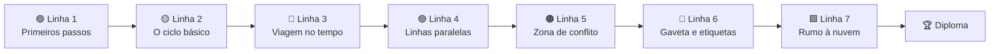

<div align="center">


<p>
  <b>🇧🇷 Português</b> ·
  <a href="i18n/README.en.md">🇬🇧 English</a> ·
  <a href="i18n/README.es.md">🇪🇸 Español</a> ·
  <a href="i18n/README.fr.md">🇫🇷 Français</a> ·
  <a href="i18n/README.de.md">🇩🇪 Deutsch</a> ·
  <a href="i18n/README.it.md">🇮🇹 Italiano</a> ·
  <a href="i18n/README.ru.md">🇷🇺 Русский</a> ·
  <a href="i18n/README.hi.md">🇮🇳 हिन्दी</a>
</p>

# 🚇 Git Quest

### Aprenda Git **jogando**. Digite comandos de verdade, conquiste estações e chegue à nuvem.

<p>
  
  
  
  
  
  
</p>

<p>
  
  
  
  
</p>

<a href="https://gitquestgame.vercel.app/"></a>
<a href="https://bruno-a-dias.github.io/git-quest/"></a>

**[▶️ Jogar (Vercel)](https://gitquestgame.vercel.app/)** · **[▶️ Jogar (GitHub Pages)](https://bruno-a-dias.github.io/git-quest/)** · **[📚 Como funciona](#-como-funciona-por-dentro)** · **[🧑‍🏫 Para professores](#-para-professores)** · **[🛠️ Rodar localmente](#%EF%B8%8F-rodar-localmente)**

</div>

---

## 🔗 Jogue agora

| Onde | Link |
|---|---|
| 🟣 **Vercel** (principal) | [gitquestgame.vercel.app](https://gitquestgame.vercel.app/) |
| ⚫ **GitHub Pages** (espelho) | [bruno-a-dias.github.io/git-quest](https://bruno-a-dias.github.io/git-quest/) |

Os dois endereços servem exatamente os mesmos arquivos. Se um estiver fora do ar, use o outro.

---

## 🎮 O que é isso?

**Git Quest** é um jogo que roda no navegador e ensina Git do zero até o `git push`. Nada de slides cheios de comandos: o aluno recebe uma **história** (você acaba de ser contratado pela *Pizzaria do Zé*), um **objetivo** e um **terminal simulado** onde digita os comandos de verdade. O jogo confere o resultado, dá XP, sobe o nível e libera a próxima estação.

> 💡 **Nada é instalado e nada é gravado no computador.** Todo o Git roda dentro da página, num motor escrito em JavaScript puro. Errar é grátis, e é assim que se aprende.

| 🕹️ Você faz | 🧠 O jogo faz |
|---|---|
| Digita `git add .` e `git commit -m "..."` | Atualiza as 4 áreas do Git **animadas** ao lado |
| Cria uma branch e faz o merge | Desenha o **mapa de commits** com branches, tags e `HEAD` |
| Provoca (e resolve) um conflito | Mostra os marcadores `<<<<<<<` exatamente como o Git real |
| Pede ajuda com **Dica 1 → Dica 2 → Ver solução** | Reduz o XP, mas nunca deixa o aluno travado |

---

## 🗺️ O mapa do jogo: 7 linhas de metrô

Cada **mundo é uma linha** e cada **missão é uma estação** (as de losango são quizzes). O aluno só avança para a estação seguinte depois de completar a atual.



| Linha | Tema | O que o aluno aprende | Missões |
|:--:|---|---|:--:|
| 🟢 **1** | Primeiros passos | `git config`, `mkdir`, `cd`, `git init` | 3 |
| 🟡 **2** | O ciclo básico | `touch`/`echo`, `git add`, `git commit`, as áreas do Git | 5 |
| 🔴 **3** | Viagem no tempo | `git log`, `git diff`, `restore`, `commit --amend`, `revert`, `reflog` | 8 |
| 🟣 **4** | Linhas paralelas | `git branch`, `git switch`, `git merge`, apagar branch | 5 |
| 🟠 **5** | Zona de conflito | Conflito de merge e leitura dos marcadores | 2 |
| 🔵 **6** | Gaveta e etiquetas | `git stash`, `git tag` | 3 |
| 🟩 **7** | Rumo à nuvem | `git remote`, `push -u`, `pull`, `clone`, **chefe final** | 6 |

**Total: 32 missões**, sendo 26 de comando e 6 quizzes relâmpago.

---

## ✨ Recursos que prendem a atenção

- 🖥️ **Terminal de verdade**: histórico com ↑ ↓, `Tab` completa comandos e arquivos, atalhos clicáveis (`ls`, `git status`, `git log --oneline`…) e sugestão de comando quando o aluno erra a digitação.
- 🧩 **As 4 áreas do Git, animadas**: pasta de trabalho → staging → repositório → remoto. Os arquivos "voam" de uma área para outra a cada `add`, `commit` e `push`.
- 🌿 **Mapa de commits ao vivo**: grafo estilo mapa de metrô com branches, tags, `HEAD` e o remoto, atualizado a cada comando.
- ⚡ **XP, combo e ranks**: seis níveis, do *Estagiário(a) de commits* ao *Mestre(a) do Git*. Missões seguidas sem dica acendem o combo.
- 🏅 **Conquistas**: *Primeiro commit*, *Viajante do tempo*, *Caçador de conflitos*, *Mestre da gaveta*, *Cabeça nas nuvens*, *Clonador*, *Chefão derrotado* e *Sem muletas*.
- 💡 **Dicas em três degraus**: Dica 1, Dica 2 e Ver solução (cada linha da solução é clicável e já cai no terminal).
- 🎉 **Confete, sons e toasts** (o som vem desligado e o aluno liga se quiser).
- 🎓 **Diploma final** com o nome do aluno, XP, título e conquistas, pronto para o print.
- 💾 **Progresso salvo** no navegador, com botão para recomeçar tudo.
- 🌍 **8 idiomas, trocados com um clique** (bandeiras no topo): 🇧🇷 Português, 🇬🇧 English, 🇪🇸 Español, 🇫🇷 Français, 🇩🇪 Deutsch, 🇮🇹 Italiano, 🇷🇺 Русский e 🇮🇳 हिन्दी. Missões, dicas, quizzes, conquistas e até as mensagens do terminal são traduzidos, e a escolha fica salva.
- 📱 **Responsivo**: funciona no celular, e respeita `prefers-reduced-motion`.

<div align="center">

| Merge e mapa de commits | Resolvendo conflito |
|:--:|:--:|
|  |  |

| Rumo à nuvem (push) | Quiz relâmpago | No celular |
|:--:|:--:|:--:|
|  |  |  |

| 🇮🇳 Em hindi | 🇩🇪 Em alemão |
|:--:|:--:|
|  |  |

</div>

---

## 🌍 Idiomas

| | Idioma | | Idioma |
|:--:|---|:--:|---|
| 🇧🇷 | Português (base) | 🇮🇳 | हिन्दी (Hindi) |
| 🇬🇧 | English | 🇷🇺 | Русский |
| 🇪🇸 | Español | 🇮🇹 | Italiano |
| 🇫🇷 | Français | 🇩🇪 | Deutsch |

As bandeiras do jogo são **SVG desenhados à mão** (emoji de bandeira não aparece no Windows). O idioma inicial segue o do navegador e a escolha do aluno fica salva.

**Quer adicionar outro idioma?** Copie `js/lang/en.js` para `js/lang/xx.js`, traduza, inclua a bandeira em `js/i18n.js` (lista `LANGS`) e o `<script>` no `index.html`. O `npm test` confere se nada ficou faltando.

> Os comandos (`git commit`, `git switch -c`…) nunca são traduzidos, porque o aluno precisa digitar o comando real. A saída do Git continua em inglês, como no Git de verdade.

---

## 🧰 Comandos suportados no simulador

**Git (30):** `config` · `init` · `status` · `add` · `commit` · `log` · `show` · `diff` · `restore` · `reset` · `revert` · `rm` · `mv` · `clean` · `branch` · `switch` · `checkout` · `merge` · `cherry-pick` · `stash` · `tag` · `remote` · `push` · `fetch` · `pull` · `clone` · `reflog` · `ls-files` · `rev-parse` · `help`

**Shell:** `ls` · `cat` · `touch` · `echo` (com `>` e `>>`) · `mkdir` · `cd` · `pwd` · `rm` · `clear`

Também entende `HEAD~n`, `HEAD^`, `HEAD@{n}`, `.gitignore`, aliases (`git config alias.*`) e conflitos de merge de verdade (três vias, com marcadores).

---

## 🧑‍🏫 Para professores

Pensado para a sala de aula:

- 🔓 **Modo professor:** abra a página com `#professor` no final do endereço (`https://gitquestgame.vercel.app/#professor`) para liberar todas as missões, ótimo para demonstrar qualquer assunto ao vivo.
- 📖 Cada missão indica a **parte do guia** correspondente (Partes 1 a 14), para casar o jogo com o material de referência.
- 🔁 Pode ser usado como **aquecimento** (10 minutos), **laboratório** ou **tarefa de casa**: o progresso fica salvo no navegador de cada aluno.
- 🔒 Sem login, sem servidor, sem coleta de dados. Basta hospedar os arquivos estáticos (GitHub Pages, Vercel, Netlify ou um pendrive).
- 🧪 As 26 missões de comando têm **solução testada automaticamente** em todos os idiomas (`npm test`), então nenhuma estação fica impossível.

> **Sugestão de aula:** projete o jogo, jogue a Linha 1 com a turma e depois deixe cada aluno seguir no próprio ritmo. Quem terminar primeiro gera o diploma e ajuda os colegas.

---

## 🛠️ Rodar localmente

Não precisa de build, bundler nem `npm install`. São arquivos estáticos.

```bash
git clone https://github.com/bruno-a-dias/git-quest.git
cd git-quest

# opção 1: abrir direto no navegador
open index.html            # macOS  (Linux: xdg-open · Windows: start)

# opção 2: servidor local
npx serve .                # ou: python3 -m http.server 8080
```

### ✅ Testes (Node 18+)

```bash
npm test
```

Roda três suítes: a do **motor de Git** (mais de 100 verificações de comandos e mensagens) a de **missões**, que executa a solução de cada missão e confirma que todos os objetivos são atingidos, e a de **idiomas**, que garante que cada tradução tenha todas as 32 missões, textos e conquistas, e que os comandos citados nas dicas não foram alterados.

### 🌐 Publicar no GitHub Pages

1. Envie o repositório para o GitHub.
2. Vá em **Settings → Pages**.
3. Em *Build and deployment*, escolha **Deploy from a branch**, branch `main` e pasta `/ (root)`.
4. Em alguns minutos o jogo estará em `https://bruno-a-dias.github.io/git-quest/`.
5. (Opcional) **Vercel:** importe o repositório em [vercel.com/new](https://vercel.com/new), deixe *Framework Preset* em **Other** e sem comando de build. A versão oficial deste projeto está em `https://gitquestgame.vercel.app/`.

---

## 🧱 Como funciona por dentro

```
git-quest/
├── index.html              # estrutura da página e ordem dos scripts
├── css/
│   └── style.css           # visual "mapa de metrô em papel quadriculado escuro"
├── js/
│   ├── git-engine.js       # motor de Git + mini shell (puro JS, sem dependências)
│   ├── missions.js         # mundos, missões, quizzes, ranks e conquistas (os DADOS, em português)
│   ├── i18n.js             # motor de idiomas + bandeiras SVG
│   ├── lang/               # um arquivo por idioma: en, es, fr, de, it, ru, hi
│   ├── core.js             # preparo da missão e avaliação dos objetivos
│   ├── ui-panels.js        # HUD, mapa de linhas, áreas do Git, grafo, sons, confete
│   └── ui-game.js          # terminal, fluxo de missão, dicas, diploma, inicialização
├── tests/
│   ├── test-engine.js      # testes do simulador de Git
│   ├── test-missions.js    # toda missão precisa ser completável pela solução
│   └── test-i18n.js        # todo idioma precisa estar completo e coerente
├── i18n/                   # este README em outros idiomas
├── docs/                   # capturas de tela usadas neste README
├── package.json
├── LICENSE
└── README.md
```

Os scripts são clássicos (sem módulos) e **carregados nesta ordem**, porque compartilham escopo global:

```html
<script src="js/git-engine.js"></script>  <!-- createGit()                       -->
<script src="js/missions.js"></script>    <!-- WORLDS, MISSIONS, RANKS, BADGES  -->
<script src="js/i18n.js"></script>        <!-- I18N (idiomas e bandeiras)      -->
<script src="js/lang/en.js"></script>     <!-- ...um arquivo por idioma        -->
<script src="js/core.js"></script>        <!-- startMission, stepMission, ...   -->
<script src="js/ui-panels.js"></script>   <!-- window.GQ                        -->
<script src="js/ui-game.js"></script>     <!-- liga tudo e inicia o jogo        -->
```

### 🔬 O motor de Git

Um repositório é só um objeto JavaScript: `{ head, branches, commits, index, stash, tags, remotes, server, reflog… }`. Cada comando lê e altera esse modelo e devolve linhas coloridas para o terminal. Há `diff` por LCS, `merge` de três vias com detecção de conflito, `reflog`, `stash` e um "servidor" simulado para `push`, `fetch`, `pull` e `clone`. Para ensinar sem cobrar nada, o resultado é fiel ao Git real nos casos que as aulas usam.

### 🎯 Como uma missão é definida

Adicionar uma estação nova é só acrescentar um objeto em `js/missions.js`:

```js
{
  w: 3,                          // índice da linha (mundo)
  title: 'Abrindo uma linha paralela',
  doc: 'Parte 8',                // parte do guia
  story: 'O dono quer testar sabores novos sem mexer no cardápio oficial…',
  setup: BASE,                   // comandos que preparam o cenário (silenciosos)
  goals: [                       // objetivos verificados, não só "digitou certo"
    { t: 'Criar a branch feature/sabores', ok: (g, ctx) => /* checa o estado */ },
  ],
  hints: ['Dica 1…', 'Dica 2…'],
  solution: ['git switch -c feature/sabores'],
  learn: 'O que o aluno leva da missão.'
}
```

Os objetivos olham o **estado do repositório** (`ok(g, ctx)`), então vale qualquer caminho correto: `git switch -c`, `git checkout -b` ou `git branch` + `git switch`.

### 🧮 Pontuação

| Situação | XP |
|---|:--:|
| Missão de comando (sem dicas) | **100** |
| Cada dica usada | −25 (mínimo 20) |
| Bônus: sem erros **e** sem dicas | **+25** |
| Quiz na 1ª tentativa / 2ª / 3ª ou mais | **50 / 25 / 10** |

Os ranks sobem em frações do total de XP possível, então a jornada tem o mesmo ritmo mesmo se novas missões forem criadas.

---

## 🤝 Contribuindo

Ideias que ficariam ótimas:

- [ ] Mundo extra com `rebase`, `bisect` e `git worktree`
- [ ] Modo desafio cronometrado
- [ ] Placar da turma (exportar/importar o progresso em um arquivo)
- [ ] Mais idiomas (japonês, árabe, chinês…)
- [ ] Novos cenários além da *Pizzaria do Zé*

Abra uma *issue* com a ideia ou envie um *pull request*. Antes, rode `npm test` e leia o [`CONTRIBUTING.md`](CONTRIBUTING.md).


<h2 align="center">Heróis do Git Quest 🛡️</h2>

<table align="center" style="background-color: #121212; border-radius: 10px; border: none;">
  <tr>
    <!-- Card do Criador (Bruno) -->
    <td align="center" width="220" style="padding: 15px; border: 1px solid #FFD700; border-radius: 8px;">
      <a href="https://github.com/bruno-a-dias">
        <br />
        <br />
        <sub><b style="font-size: 16px; color: #FFFFFF;">Bruno Assunção Dias</b></sub>
      </a><br />
      <span style="color: #FFD700; font-weight: bold;">👑 Criador / Mantenedor</span><br />
      <sub style="color: #A0A0A0;">DevQuest / Git Quest</sub>
    </td>

    <!-- NOVO_CONTRIBUIDOR_AQUI -->

  </tr>
</table>
---

## 👨‍🏫 Autor

**Prof. Me. Bruno Assunção Dias**: professor de Tecnologia da Informação no **IESB**, em Brasília-DF.
GitHub: [@bruno-a-dias](https://github.com/bruno-a-dias)

Feito com ☕ e muito `git commit` para que os alunos **percam o medo do terminal**.

## 📄 Licença

Distribuído sob a licença **MIT**. Veja [`LICENSE`](LICENSE). Use, adapte e leve para a sua sala de aula.

<div align="center">

⭐ Se o Git Quest ajudou a sua turma, deixe uma estrela no repositório!

</div>
