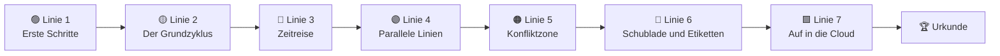

<div align="center">


<p>
  <a href="../README.md">🇧🇷 Português</a> ·
  <a href="README.en.md">🇬🇧 English</a> ·
  <a href="README.es.md">🇪🇸 Español</a> ·
  <a href="README.fr.md">🇫🇷 Français</a> ·
  <b>🇩🇪 Deutsch</b> ·
  <a href="README.it.md">🇮🇹 Italiano</a> ·
  <a href="README.ru.md">🇷🇺 Русский</a> ·
  <a href="README.hi.md">🇮🇳 हिन्दी</a>
</p>

# 🚇 Git Quest

### Lerne Git **spielend**. Tippe echte Befehle, erobere Stationen und erreiche die Cloud.

<p>
  
  
  
  
  
  
</p>

<a href="https://gitquestgame.vercel.app/"></a>
<a href="https://bruno-a-dias.github.io/git-quest/"></a>

</div>

---

## 🔗 Jetzt spielen

| Wo | Link |
|---|---|
| 🟣 **Vercel** (Haupt) | [gitquestgame.vercel.app](https://gitquestgame.vercel.app/) |
| ⚫ **GitHub Pages** (Spiegel) | [bruno-a-dias.github.io/git-quest](https://bruno-a-dias.github.io/git-quest/) |

Beide Adressen liefern genau dieselben Dateien. Ist eine nicht erreichbar, nimm die andere.

---

## 🎮 Was ist das?

**Git Quest** ist ein Browserspiel, das Git von null bis `git push` beibringt. Keine Folien voller Befehle: Die Lernenden bekommen eine **Geschichte** (du wurdest gerade von der *Pizzaria do Zé* eingestellt), ein **Ziel** und ein **simuliertes Terminal**, in dem echte Befehle getippt werden. Das Spiel prüft das Ergebnis, vergibt XP, steigt im Level auf und schaltet die nächste Station frei.

> 💡 **Es wird nichts installiert und nichts auf deinem Computer gespeichert.** Das ganze Git läuft in der Seite, in einer Engine aus reinem JavaScript. Fehler kosten nichts, und genau so lernt man.

| 🕹️ Du | 🧠 Das Spiel |
|---|---|
| Tippst `git add .` und `git commit -m "..."` | Aktualisiert die 4 **animierten** Git-Bereiche neben dem Terminal |
| Erstellst einen Branch und mergst ihn | Zeichnet die **Commit-Karte** mit Branches, Tags und `HEAD` |
| Löst einen Konflikt aus (und löst ihn auf) | Zeigt die `<<<<<<<`-Markierungen genau wie echtes Git |
| Bittest um Hilfe: **Tipp 1 → Tipp 2 → Lösung zeigen** | Senkt die XP, lässt die Lernenden aber nie hängen |

---

## 🗺️ Die Spielkarte: 7 Metro-Linien

Jede **Welt ist eine Linie** und jede **Mission eine Station** (Rauten sind Quizze). Die nächste Station wird erst nach der aktuellen freigeschaltet.



| Linie | Thema | Was gelernt wird | Missionen |
|:--:|---|---|:--:|
| 🟢 **1** | Erste Schritte | `git config`, `mkdir`, `cd`, `git init` | 3 |
| 🟡 **2** | Der Grundzyklus | `touch`/`echo`, `git add`, `git commit`, die Git-Bereiche | 5 |
| 🔴 **3** | Zeitreise | `git log`, `git diff`, `restore`, `commit --amend`, `revert`, `reflog` | 8 |
| 🟣 **4** | Parallele Linien | `git branch`, `git switch`, `git merge`, Branches löschen | 5 |
| 🟠 **5** | Konfliktzone | Merge-Konflikte und Markierungen lesen | 2 |
| 🔵 **6** | Schublade und Etiketten | `git stash`, `git tag` | 3 |
| 🟩 **7** | Auf in die Cloud | `git remote`, `push -u`, `pull`, `clone`, **Endgegner** | 6 |

**32 Missionen insgesamt**: 26 Befehlsmissionen und 6 Blitz-Quizze.

---

## ✨ Funktionen, die bei der Stange halten

- 🖥️ **Ein Terminal, das sich echt anfühlt**: Verlauf mit ↑ ↓, `Tab` vervollständigt Befehle und Dateien, klickbare Kürzel und ein Vorschlag bei Tippfehlern.
- 🧩 **Die 4 Git-Bereiche, animiert**: Arbeitsordner → Staging → Repository → Remote. Bei jedem `add`, `commit` und `push` „fliegen“ Dateien zwischen den Bereichen.
- 🌿 **Live-Commit-Karte**: ein Graph im Metro-Stil mit Branches, Tags, `HEAD` und Remote, nach jedem Befehl aktualisiert.
- ⚡ **XP, Combo und Ränge**: sechs Level, vom *Commit-Praktikanten* bis zum *Git-Meister*. Missionen in Folge ohne Tipps zünden die Combo.
- 🏅 **Erfolge**: *Erster Commit*, *Zeitreisender*, *Konfliktjäger*, *Schubladenmeister*, *Kopf in den Wolken*, *Klonierer*, *Endgegner besiegt* und *Ohne Krücken*.
- 💡 **Tipps in drei Stufen**: Tipp 1, Tipp 2 und Lösung zeigen (jede Lösungszeile ist klickbar und landet im Terminal).
- 🎉 **Konfetti, Sound und Hinweise** (der Ton ist anfangs aus; wer mag, schaltet ihn ein).
- 🎓 **Abschlussurkunde** mit Namen, XP, Titel und Erfolgen, bereit für den Screenshot.
- 💾 **Fortschritt gespeichert** im Browser, mit Knopf zum Neustart.
- 🌍 **8 Sprachen per Klick** (Flaggen oben): Missionen, Tipps, Quizze, Erfolge und sogar Terminal-Meldungen sind übersetzt, die Wahl wird gemerkt.
- 📱 **Responsiv**: läuft auf dem Handy und beachtet `prefers-reduced-motion`.

<div align="center">

| Merge und Commit-Karte | Einen Konflikt lösen |
|:--:|:--:|
|  |  |

| Auf in die Cloud (push) | Blitz-Quiz | Auf dem Handy |
|:--:|:--:|:--:|
|  |  |  |

| 🇮🇳 Auf Hindi | 🇩🇪 Auf Deutsch |
|:--:|:--:|
|  |  |

</div>

---

## 🌍 Sprachen

| | Sprache | | Sprache |
|:--:|---|:--:|---|
| 🇧🇷 | Português | 🇮🇳 | हिन्दी (Hindi) |
| 🇬🇧 | English | 🇷🇺 | Русский |
| 🇪🇸 | Español | 🇮🇹 | Italiano |
| 🇫🇷 | Français | 🇩🇪 | Deutsch |

Die Flaggen im Spiel sind **von Hand gezeichnete SVGs** (Flaggen-Emoji werden unter Windows nicht dargestellt). Die Startsprache folgt dem Browser, die Wahl der Lernenden wird gespeichert.

**Eine weitere Sprache hinzufügen?** Kopiere `js/lang/en.js` nach `js/lang/xx.js`, übersetze die Datei, ergänze die Flagge in der Liste `LANGS` in `js/i18n.js` und das `<script>`-Tag in `index.html`. `npm test` prüft, dass nichts fehlt.

> Befehle (`git commit`, `git switch -c`…) werden nie übersetzt, denn die Lernenden müssen den echten Befehl tippen. Die Ausgabe von Git bleibt Englisch, wie im echten Git.

---

## 🧰 Vom Simulator unterstützte Befehle

**Git (30):** `config` · `init` · `status` · `add` · `commit` · `log` · `show` · `diff` · `restore` · `reset` · `revert` · `rm` · `mv` · `clean` · `branch` · `switch` · `checkout` · `merge` · `cherry-pick` · `stash` · `tag` · `remote` · `push` · `fetch` · `pull` · `clone` · `reflog` · `ls-files` · `rev-parse` · `help`

**Shell:** `ls` · `cat` · `touch` · `echo` (`>` / `>>`) · `mkdir` · `cd` · `pwd` · `rm` · `clear`

Er versteht außerdem `HEAD~n`, `HEAD^`, `HEAD@{n}`, `.gitignore`, Aliase (`git config alias.*`) und echte Merge-Konflikte (Drei-Wege-Merge, mit Markierungen).

---

## 🧑‍🏫 Für Lehrkräfte

Für den Unterricht gemacht:

- 🔓 **Lehrermodus:** Öffne die Seite mit `#professor` am Ende der Adresse (`https://gitquestgame.vercel.app/#professor`), um alle Missionen freizuschalten, ideal für Live-Demos zu jedem Thema.
- 📖 Jede Mission nennt den passenden **Teil der Anleitung** (Teile 1 bis 14), damit das Spiel zum Begleitmaterial passt.
- 🔁 Als **Aufwärmübung** (10 Minuten), **Labor** oder **Hausaufgabe** nutzbar: Der Fortschritt wird im Browser jedes Lernenden gespeichert.
- 🔒 Kein Login, kein Server, keine Datenerhebung. Es genügt, die statischen Dateien zu hosten (GitHub Pages, Vercel, Netlify oder ein USB-Stick).
- 🧪 Die 26 Befehlsmissionen haben eine **automatisch getestete Lösung** in allen Sprachen (`npm test`), keine Station ist also unlösbar.

> **Unterrichtsidee:** Projiziere das Spiel, spielt Linie 1 gemeinsam und lass dann alle in ihrem Tempo weitermachen. Wer zuerst fertig ist, erzeugt die Urkunde und hilft den anderen.

---

## 🛠️ Lokal starten

Kein Build, kein Bundler, kein `npm install`. Nur statische Dateien.

```bash
git clone https://github.com/bruno-a-dias/git-quest.git
cd git-quest

# Option 1: direkt im Browser öffnen
open index.html            # macOS  (Linux: xdg-open · Windows: start)

# Option 2: lokaler Server
npx serve .                # python3 -m http.server 8080
```

### ✅ Tests (Node 18+)

```bash
npm test
```

Führt drei Suiten aus: die des **Git-Motors** (über 100 Prüfungen von Befehlen und Meldungen), die der **Missionen** (jede Lösung wird ausgeführt und alle Ziele müssen erreicht werden) und die der **Sprachen** (jede Übersetzung muss alle 32 Missionen, Texte und Erfolge enthalten, und die in den Tipps genannten Befehle dürfen sich nicht geändert haben).

### 🌐 Auf GitHub Pages veröffentlichen

1. Schiebe das Repository zu GitHub.
2. Öffne **Settings → Pages**.
3. Wähle unter *Build and deployment* **Deploy from a branch**, Branch `main` und Ordner `/ (root)`.
4. In wenigen Minuten ist das Spiel unter `https://bruno-a-dias.github.io/git-quest/` erreichbar.
5. (Optional) **Vercel:** Importiere das Repository unter [vercel.com/new](https://vercel.com/new), lass *Framework Preset* auf **Other** und ohne Build-Befehl. Die offizielle Version liegt unter `https://gitquestgame.vercel.app/`.

---

## 🧱 So funktioniert es intern

```
git-quest/
├── index.html              # Seitenstruktur und Reihenfolge der Skripte
├── css/
│   └── style.css           # Look „Metro-Plan auf dunklem Rechenpapier“
├── js/
│   ├── git-engine.js       # Git-Motor + Mini-Shell (reines JS, ohne Abhängigkeiten)
│   ├── missions.js         # Welten, Missionen, Quizze, Ränge und Erfolge (die DATEN, auf Portugiesisch)
│   ├── i18n.js             # Sprachmotor + SVG-Flaggen
│   ├── lang/               # eine Datei pro Sprache: en, es, fr, de, it, ru, hi
│   ├── core.js             # Missionsvorbereitung und Zielauswertung
│   ├── ui-panels.js        # HUD, Linienplan, Git-Bereiche, Graph, Sounds, Konfetti
│   └── ui-game.js          # Terminal, Missionsablauf, Tipps, Urkunde, Start
├── tests/                  # Tests für Motor, Missionen und Sprachen
├── i18n/                   # diese README in anderen Sprachen
├── docs/                   # Screenshots für die READMEs
├── package.json
├── LICENSE
└── README.md
```

Die Skripte sind klassisch (ohne Module) und werden **in dieser Reihenfolge geladen**, da sie den globalen Scope teilen:

```html
<script src="js/git-engine.js"></script>
<script src="js/missions.js"></script>
<script src="js/i18n.js"></script>
<script src="js/lang/en.js"></script>   <!-- ... -->
<script src="js/core.js"></script>
<script src="js/ui-panels.js"></script>
<script src="js/ui-game.js"></script>
```

### 🔬 Der Git-Motor

Ein Repository ist nur ein JavaScript-Objekt: `{ head, branches, commits, index, stash, tags, remotes, server, reflog… }`. Jeder Befehl liest und ändert dieses Modell und liefert farbige Zeilen für das Terminal. Es gibt ein LCS-basiertes `diff`, einen Drei-Wege-`merge` mit Konflikterkennung, `reflog`, `stash` und einen simulierten „Server“ für `push`, `fetch`, `pull` und `clone`. In den Fällen, die im Unterricht vorkommen, entspricht das Ergebnis dem echten Git.

### 🎯 Wie eine Mission definiert wird

Eine Station hinzuzufügen heißt, ein Objekt in `js/missions.js` (der Basistext ist Portugiesisch) und seine Übersetzung in jede `js/lang/*.js`-Datei einzutragen:

```js
{
  w: 3,                          // Index der Welt (Linie)
  title: 'Abrindo uma linha paralela',
  doc: 'Parte 8',
  story: '...',
  setup: BASE,                   // stille Befehle, die das Szenario vorbereiten
  goals: [                       // geprüfte Ziele, nicht nur „richtig getippt“
    { t: 'Criar a branch feature/sabores', ok: (g, ctx) => /* ... */ },
  ],
  hints: ['...', '...'],
  solution: ['git switch -c feature/sabores'],
  learn: '...'
}
```

Die Ziele prüfen den **Zustand des Repositorys** (`ok(g, ctx)`), also gilt jeder richtige Weg: `git switch -c`, `git checkout -b` oder `git branch` + `git switch`.

### 🧮 Punktesystem

| Situation | XP |
|---|:--:|
| Befehlsmission (ohne Tipps) | **100** |
| Jeder genutzte Tipp | −25 (min 20) |
| Bonus: ohne Fehler **und** ohne Tipps | **+25** |
| Quiz beim 1. / 2. / 3.+ Versuch | **50 / 25 / 10** |

Die Ränge steigen bei Bruchteilen der maximal möglichen XP, der Weg behält also dasselbe Tempo, auch wenn neue Missionen dazukommen.

---

## 🤝 Mitmachen

Ideen, die großartig wären:

- [ ] Eine Extra-Welt mit `rebase`, `bisect` und `git worktree`
- [ ] Zeitlimit-Modus
- [ ] Klassen-Rangliste (Fortschritt als Datei exportieren/importieren)
- [ ] Weitere Sprachen (Japanisch, Arabisch, Chinesisch…)
- [ ] Neue Szenarien neben der *Pizzaria do Zé*

Eröffne ein *Issue* mit deiner Idee oder sende einen *Pull Request*. Führe vorher `npm test` aus.


<h2 align="center">Helden von Git Quest 🛡️</h2>

<table align="center" style="background-color: #121212; border-radius: 10px; border: none;">
  <tr>
    <!-- Card do Criador (Bruno) -->
    <td align="center" width="220" style="padding: 15px; border: 1px solid #FFD700; border-radius: 8px;">
      <a href="https://github.com/bruno-a-dias">
        <br />
        <br />
        <sub><b style="font-size: 16px; color: #FFFFFF;">Bruno Assunção Dias</b></sub>
      </a><br />
      <span style="color: #FFD700; font-weight: bold;">👑 Entwickler / Maintainer</span><br />
      <sub style="color: #A0A0A0;">DevQuest / Git Quest</sub>
    </td>

    <!-- NOVO_CONTRIBUIDOR_AQUI -->

  </tr>
</table>

---

## 👨‍🏫 Autor

**Prof. Me. Bruno Assunção Dias** · Professor für Informationstechnologie am **IESB**, Brasília-DF, Brasilien.
GitHub: [@bruno-a-dias](https://github.com/bruno-a-dias)

Gemacht mit ☕ und vielen `git commit`, damit Lernende **die Angst vor dem Terminal verlieren**.

## 📄 Lizenz

Veröffentlicht unter der **MIT**-Lizenz. Siehe [`LICENSE`](../LICENSE). Nutze es, passe es an und bring es in deinen Unterricht.

<div align="center">

⭐ Hat Git Quest deiner Klasse geholfen? Gib dem Repository einen Stern!

</div>
