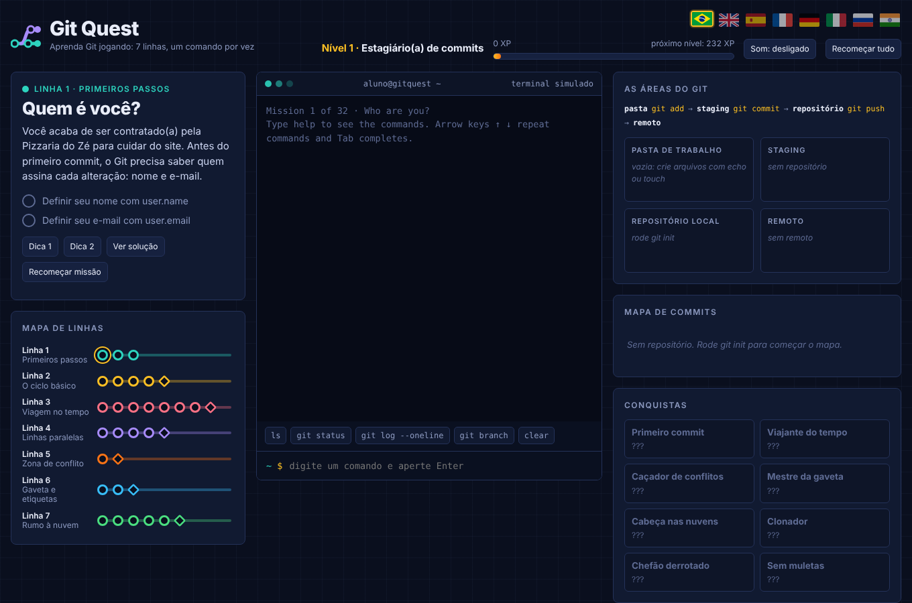
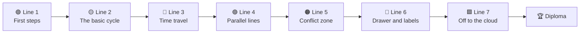
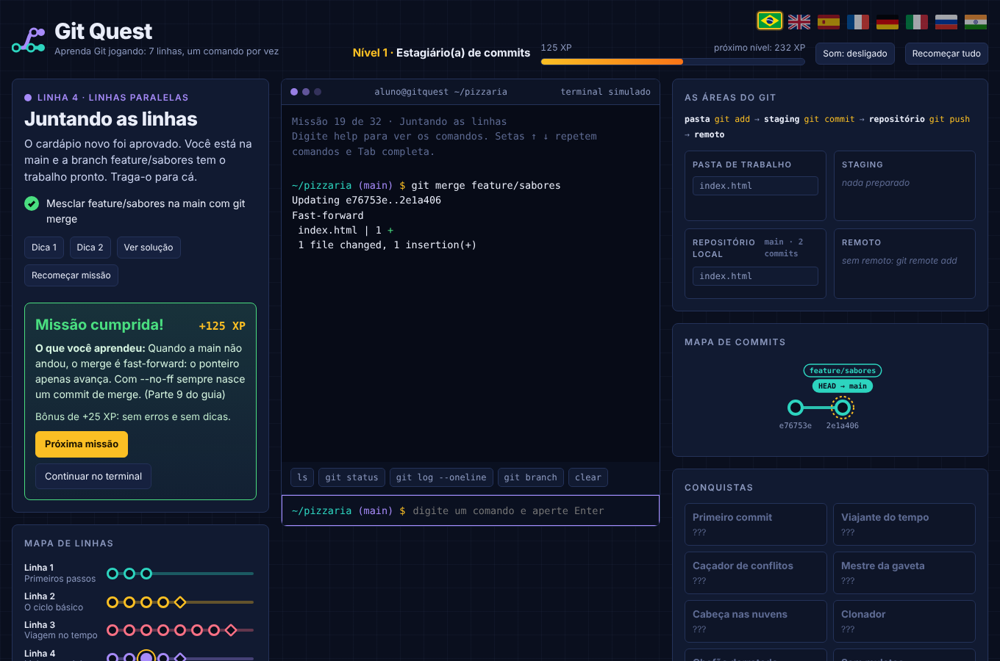
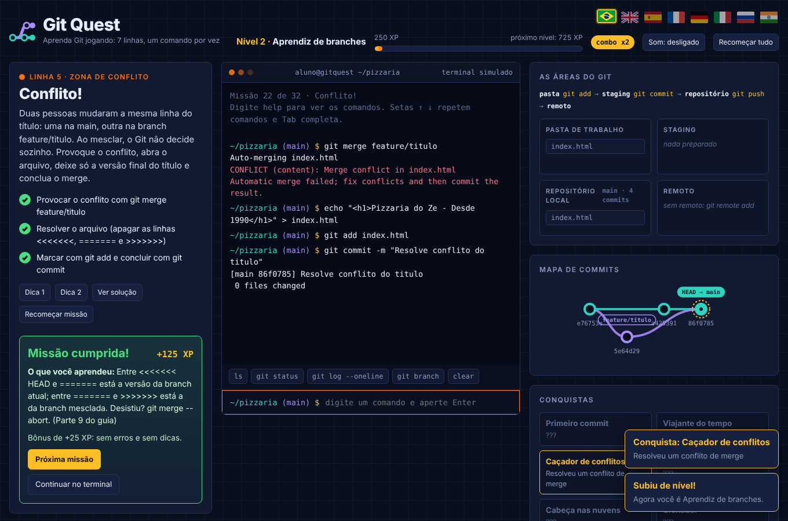
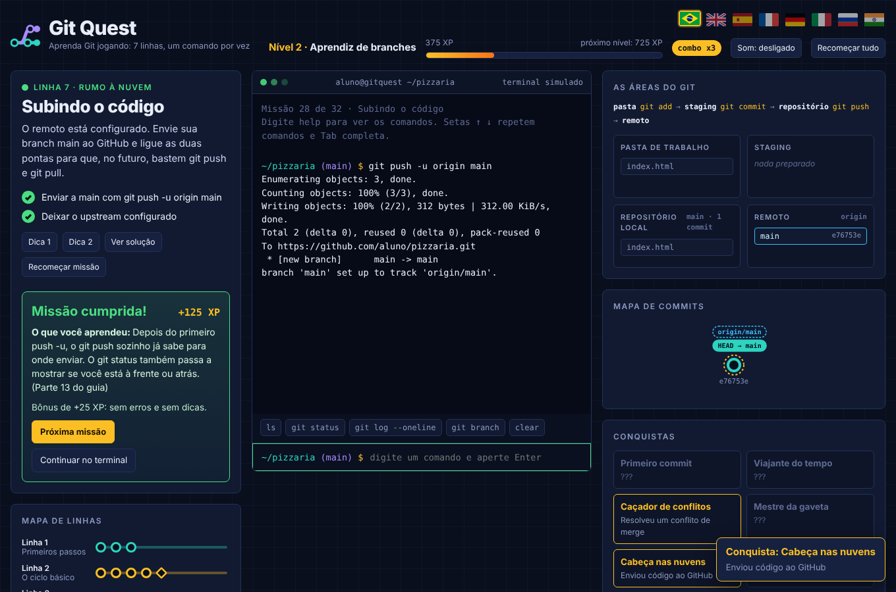
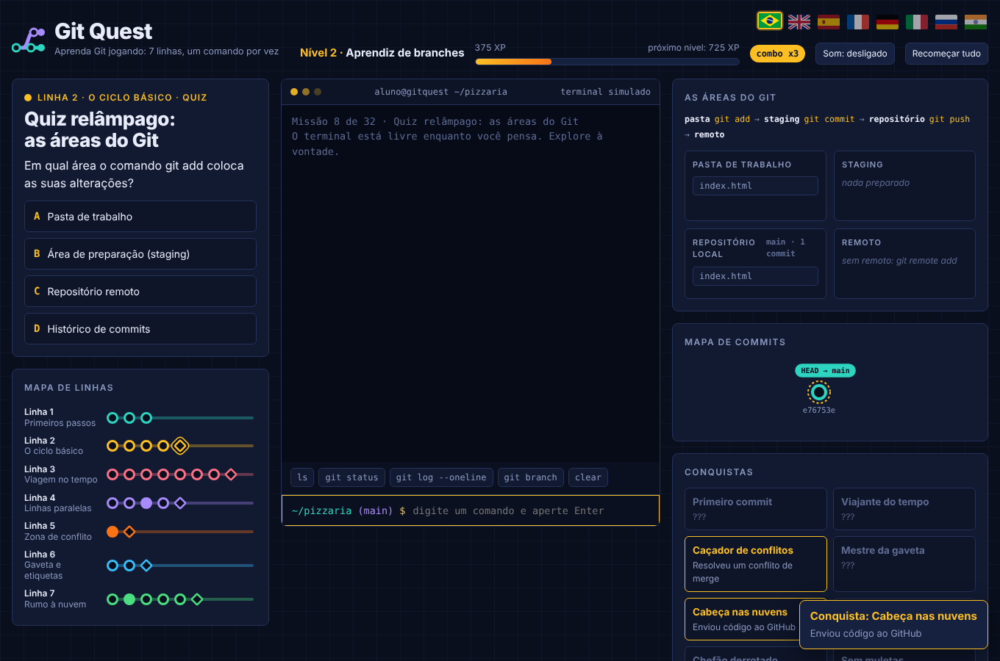
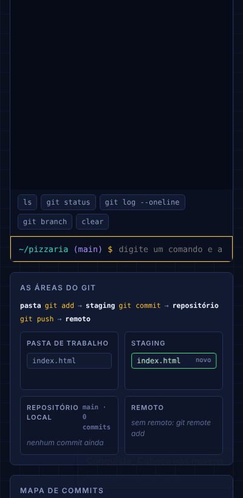
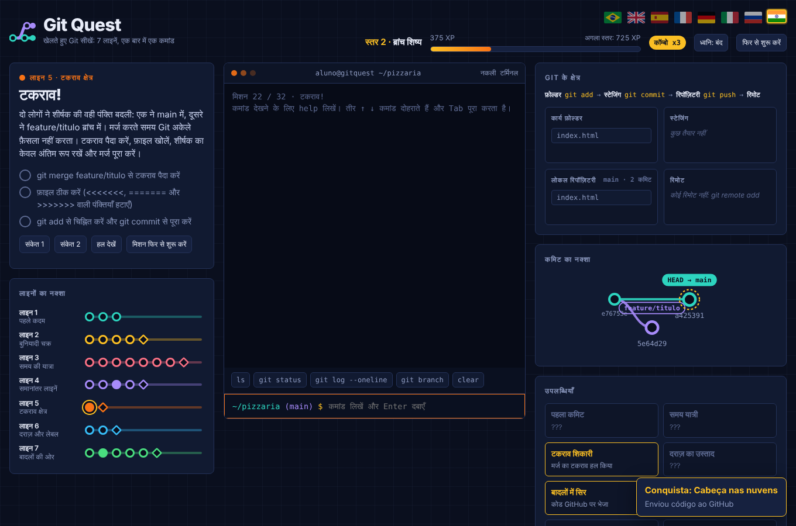
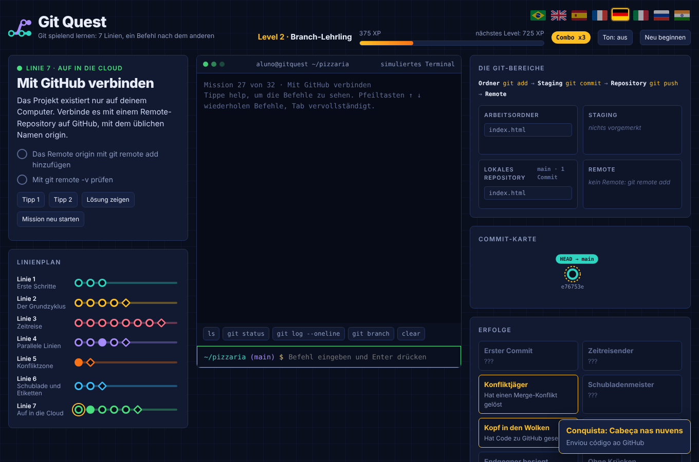

<div align="center">



<p>
  <a href="../README.md">🇧🇷 Português</a> ·
  <b>🇬🇧 English</b> ·
  <a href="README.es.md">🇪🇸 Español</a> ·
  <a href="README.fr.md">🇫🇷 Français</a> ·
  <a href="README.de.md">🇩🇪 Deutsch</a> ·
  <a href="README.it.md">🇮🇹 Italiano</a> ·
  <a href="README.ru.md">🇷🇺 Русский</a> ·
  <a href="README.hi.md">🇮🇳 हिन्दी</a>
</p>

# 🚇 Git Quest

### Learn Git by **playing**. Type real commands, win stations, and reach the cloud.

<p>
  
  
  
  
  
  
</p>

<a href="https://gitquestgame.vercel.app/"></a>
<a href="https://bruno-a-dias.github.io/git-quest/"></a>

</div>

---

## 🔗 Play now

| Where | Link |
|---|---|
| 🟣 **Vercel** (main) | [gitquestgame.vercel.app](https://gitquestgame.vercel.app/) |
| ⚫ **GitHub Pages** (mirror) | [bruno-a-dias.github.io/git-quest](https://bruno-a-dias.github.io/git-quest/) |

Both addresses serve exactly the same files. If one is down, use the other.

---

## 🎮 What is this?

**Git Quest** is a browser game that teaches Git from zero to `git push`. No slides full of commands: the student gets a **story** (you have just been hired by *Pizzaria do Zé*), a **goal** and a **simulated terminal** where real commands are typed. The game checks the result, awards XP, levels up and unlocks the next station.

> 💡 **Nothing is installed and nothing is written to your computer.** All of Git runs inside the page, in an engine written in plain JavaScript. Making mistakes is free, and that is how people learn.

| 🕹️ You | 🧠 The game |
|---|---|
| Type `git add .` and `git commit -m "..."` | Updates the 4 **animated** Git areas next to the terminal |
| Create a branch and merge it | Draws the **commit map** with branches, tags and `HEAD` |
| Cause (and resolve) a conflict | Shows the `<<<<<<<` markers exactly like real Git |
| Ask for help: **Hint 1 → Hint 2 → Show solution** | Lowers the XP, but never leaves the student stuck |

---

## 🗺️ The game map: 7 metro lines

Every **world is a line** and every **mission is a station** (diamond ones are quizzes). Students unlock the next station only after finishing the current one.



| Line | Theme | What students learn | Missions |
|:--:|---|---|:--:|
| 🟢 **1** | First steps | `git config`, `mkdir`, `cd`, `git init` | 3 |
| 🟡 **2** | The basic cycle | `touch`/`echo`, `git add`, `git commit`, the Git areas | 5 |
| 🔴 **3** | Time travel | `git log`, `git diff`, `restore`, `commit --amend`, `revert`, `reflog` | 8 |
| 🟣 **4** | Parallel lines | `git branch`, `git switch`, `git merge`, deleting branches | 5 |
| 🟠 **5** | Conflict zone | Merge conflicts and reading the markers | 2 |
| 🔵 **6** | Drawer and labels | `git stash`, `git tag` | 3 |
| 🟩 **7** | Off to the cloud | `git remote`, `push -u`, `pull`, `clone`, **final boss** | 6 |

**32 missions in total**: 26 command missions and 6 quick quizzes.

---

## ✨ Features that hold attention

- 🖥️ **A real-feeling terminal**: ↑ ↓ history, `Tab` completes commands and files, clickable shortcuts, and a "did you mean" suggestion when a command is mistyped.
- 🧩 **The 4 Git areas, animated**: working folder → staging → repository → remote. Files "fly" between areas on every `add`, `commit` and `push`.
- 🌿 **Live commit map**: a metro-style graph with branches, tags, `HEAD` and the remote, updated after every command.
- ⚡ **XP, combo and ranks**: six levels, from *Commit Intern* to *Git Master*. Missions in a row without hints light up the combo.
- 🏅 **Achievements**: *First commit*, *Time traveler*, *Conflict hunter*, *Drawer master*, *Head in the clouds*, *Cloner*, *Boss defeated* and *No crutches*.
- 💡 **Three-step hints**: Hint 1, Hint 2 and Show solution (every solution line is clickable and drops into the terminal).
- 🎉 **Confetti, sound and toasts** (sound starts off; students turn it on if they like).
- 🎓 **Final diploma** with the student's name, XP, title and achievements, ready for a screenshot.
- 💾 **Progress saved** in the browser, with a button to start over.
- 🌍 **8 languages, one click away** (flags at the top): missions, hints, quizzes, achievements and even terminal messages are translated, and the choice is remembered.
- 📱 **Responsive**: works on phones and respects `prefers-reduced-motion`.

<div align="center">

| Merge and commit map | Solving a conflict |
|:--:|:--:|
|  |  |

| Off to the cloud (push) | Quick quiz | On a phone |
|:--:|:--:|:--:|
|  |  |  |

| 🇮🇳 In Hindi | 🇩🇪 In German |
|:--:|:--:|
|  |  |

</div>

---

## 🌍 Languages

| | Language | | Language |
|:--:|---|:--:|---|
| 🇧🇷 | Português | 🇮🇳 | हिन्दी (Hindi) |
| 🇬🇧 | English | 🇷🇺 | Русский |
| 🇪🇸 | Español | 🇮🇹 | Italiano |
| 🇫🇷 | Français | 🇩🇪 | Deutsch |

The game flags are **hand-drawn SVGs** (flag emoji do not render on Windows). The first language follows the browser, and the student's choice is saved.

**Want to add another language?** Copy `js/lang/en.js` to `js/lang/xx.js`, translate it, add the flag to the `LANGS` list in `js/i18n.js` and the `<script>` tag to `index.html`. `npm test` checks that nothing is missing.

> Commands (`git commit`, `git switch -c`…) are never translated, because students must type the real command. Git's own output stays in English, just like real Git.

---

## 🧰 Commands supported by the simulator

**Git (30):** `config` · `init` · `status` · `add` · `commit` · `log` · `show` · `diff` · `restore` · `reset` · `revert` · `rm` · `mv` · `clean` · `branch` · `switch` · `checkout` · `merge` · `cherry-pick` · `stash` · `tag` · `remote` · `push` · `fetch` · `pull` · `clone` · `reflog` · `ls-files` · `rev-parse` · `help`

**Shell:** `ls` · `cat` · `touch` · `echo` (`>` / `>>`) · `mkdir` · `cd` · `pwd` · `rm` · `clear`

It also understands `HEAD~n`, `HEAD^`, `HEAD@{n}`, `.gitignore`, aliases (`git config alias.*`) and real merge conflicts (three-way, with markers).

---

## 🧑‍🏫 For teachers

Designed for the classroom:

- 🔓 **Teacher mode:** open the page with `#professor` at the end of the address (`https://gitquestgame.vercel.app/#professor`) to unlock every mission, great for live demos of any topic.
- 📖 Every mission points to the matching **part of the guide** (Parts 1 to 14), so the game fits the reference material.
- 🔁 Use it as a **warm-up** (10 minutes), a **lab** or **homework**: progress is saved in each student's browser.
- 🔒 No login, no server, no data collection. Just host the static files (GitHub Pages, Vercel, Netlify or a USB stick).
- 🧪 The 26 command missions have an **automatically tested solution** in every language (`npm test`), so no station is impossible.

> **Lesson idea:** project the game, play Line 1 with the class, then let each student go at their own pace. Whoever finishes first generates the diploma and helps classmates.

---

## 🛠️ Run locally

No build, no bundler, no `npm install`. Just static files.

```bash
git clone https://github.com/bruno-a-dias/git-quest.git
cd git-quest

# option 1: open it directly in the browser
open index.html            # macOS  (Linux: xdg-open · Windows: start)

# option 2: local server
npx serve .                # python3 -m http.server 8080
```

### ✅ Tests (Node 18+)

```bash
npm test
```

Runs three suites: the **Git engine** (over 100 command and message checks), the **missions** (each solution is executed and every goal must be met) and the **languages** (every translation must have all 32 missions, texts and achievements, and the commands quoted in hints must be unchanged).

### 🌐 Publish on GitHub Pages

1. Push the repository to GitHub.
2. Go to **Settings → Pages**.
3. Under *Build and deployment*, choose **Deploy from a branch**, branch `main`, folder `/ (root)`.
4. In a few minutes the game will be at `https://bruno-a-dias.github.io/git-quest/`.
5. (Optional) **Vercel:** import the repository at [vercel.com/new](https://vercel.com/new), keep *Framework Preset* as **Other** and no build command. The official version of this project is at `https://gitquestgame.vercel.app/`.

---

## 🧱 How it works inside

```
git-quest/
├── index.html              # page structure and script order
├── css/
│   └── style.css           # "metro map on dark graph paper" look
├── js/
│   ├── git-engine.js       # Git engine + mini shell (plain JS, no dependencies)
│   ├── missions.js         # worlds, missions, quizzes, ranks and achievements (the DATA, in Portuguese)
│   ├── i18n.js             # language engine + SVG flags
│   ├── lang/               # one file per language: en, es, fr, de, it, ru, hi
│   ├── core.js             # mission setup and goal evaluation
│   ├── ui-panels.js        # HUD, line map, Git areas, graph, sounds, confetti
│   └── ui-game.js          # terminal, mission flow, hints, diploma, startup
├── tests/                  # engine, missions and languages tests
├── i18n/                   # this README in other languages
├── docs/                   # screenshots used in the READMEs
├── package.json
├── LICENSE
└── README.md
```

The scripts are classic (no modules) and **loaded in this order**, because they share the global scope:

```html
<script src="js/git-engine.js"></script>
<script src="js/missions.js"></script>
<script src="js/i18n.js"></script>
<script src="js/lang/en.js"></script>   <!-- ... -->
<script src="js/core.js"></script>
<script src="js/ui-panels.js"></script>
<script src="js/ui-game.js"></script>
```

### 🔬 The Git engine

A repository is just a JavaScript object: `{ head, branches, commits, index, stash, tags, remotes, server, reflog… }`. Each command reads and changes that model and returns colored lines for the terminal. There is an LCS-based `diff`, three-way `merge` with conflict detection, `reflog`, `stash` and a simulated "server" for `push`, `fetch`, `pull` and `clone`. To teach without grading on trivia, the results match real Git in the cases classes actually use.

### 🎯 How a mission is defined

Adding a station is just adding an object to `js/missions.js` (the base text is Portuguese) and its translation to each `js/lang/*.js` file:

```js
{
  w: 3,                          // world (line) index
  title: 'Abrindo uma linha paralela',
  doc: 'Parte 8',
  story: '...',
  setup: BASE,                   // silent commands that prepare the scenario
  goals: [                       // checked goals, not just "typed it right"
    { t: 'Criar a branch feature/sabores', ok: (g, ctx) => /* ... */ },
  ],
  hints: ['...', '...'],
  solution: ['git switch -c feature/sabores'],
  learn: '...'
}
```

Goals look at the **repository state** (`ok(g, ctx)`), so any correct path works: `git switch -c`, `git checkout -b`, or `git branch` + `git switch`.

### 🧮 Scoring

| Situation | XP |
|---|:--:|
| Command mission (no hints) | **100** |
| Each hint used | −25 (min 20) |
| Bonus: no mistakes **and** no hints | **+25** |
| Quiz on the 1st / 2nd / 3rd+ try | **50 / 25 / 10** |

Ranks rise at fractions of the total possible XP, so the journey keeps the same pace even if new missions are added.

---

## 🤝 Contributing

Ideas that would be great:

- [ ] An extra world with `rebase`, `bisect` and `git worktree`
- [ ] Timed challenge mode
- [ ] Class leaderboard (export/import progress as a file)
- [ ] More languages (Japanese, Arabic, Chinese…)
- [ ] New scenarios beyond *Pizzaria do Zé*

Open an *issue* with your idea or send a *pull request*. Run `npm test` first.

---

## 👨‍🏫 Author

**Prof. Me. Bruno Assunção Dias** · Professor of Information Technology at **IESB**, Brasília-DF, Brazil.
GitHub: [@bruno-a-dias](https://github.com/bruno-a-dias)

Made with ☕ and a lot of `git commit` so that students **lose their fear of the terminal**.

## 📄 License

Released under the **MIT** license. See [`LICENSE`](../LICENSE). Use it, adapt it and take it to your classroom.

<div align="center">

⭐ If Git Quest helped your class, leave a star on the repository!

</div>
