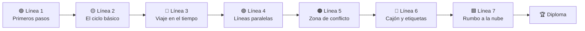

<div align="center">


<p>
  <a href="../README.md">🇧🇷 Português</a> ·
  <a href="README.en.md">🇬🇧 English</a> ·
  <b>🇪🇸 Español</b> ·
  <a href="README.fr.md">🇫🇷 Français</a> ·
  <a href="README.de.md">🇩🇪 Deutsch</a> ·
  <a href="README.it.md">🇮🇹 Italiano</a> ·
  <a href="README.ru.md">🇷🇺 Русский</a> ·
  <a href="README.hi.md">🇮🇳 हिन्दी</a>
</p>

# 🚇 Git Quest

### Aprende Git **jugando**. Escribe comandos de verdad, conquista estaciones y llega a la nube.

<p>
  
  
  
  
  
  
</p>

<a href="https://gitquestgame.vercel.app/"></a>
<a href="https://bruno-a-dias.github.io/git-quest/"></a>

</div>

---

## 🔗 Juega ahora

| Dónde | Enlace |
|---|---|
| 🟣 **Vercel** (principal) | [gitquestgame.vercel.app](https://gitquestgame.vercel.app/) |
| ⚫ **GitHub Pages** (espejo) | [bruno-a-dias.github.io/git-quest](https://bruno-a-dias.github.io/git-quest/) |

Las dos direcciones sirven exactamente los mismos archivos. Si una está caída, usa la otra.

---

## 🎮 ¿Qué es esto?

**Git Quest** es un juego que funciona en el navegador y enseña Git desde cero hasta `git push`. Nada de diapositivas llenas de comandos: el alumno recibe una **historia** (acabas de ser contratado por la *Pizzaria do Zé*), un **objetivo** y una **terminal simulada** donde escribe los comandos de verdad. El juego comprueba el resultado, da XP, sube de nivel y desbloquea la siguiente estación.

> 💡 **No se instala nada y no se guarda nada en tu ordenador.** Todo Git funciona dentro de la página, en un motor escrito en JavaScript puro. Equivocarse es gratis, y así se aprende.

| 🕹️ Tú | 🧠 El juego |
|---|---|
| Escribes `git add .` y `git commit -m "..."` | Actualiza las 4 áreas de Git **animadas** junto a la terminal |
| Creas una branch y haces el merge | Dibuja el **mapa de commits** con branches, tags y `HEAD` |
| Provocas (y resuelves) un conflicto | Muestra las marcas `<<<<<<<` igual que el Git real |
| Pides ayuda: **Pista 1 → Pista 2 → Ver solución** | Reduce el XP, pero nunca deja al alumno atascado |

---

## 🗺️ El mapa del juego: 9 líneas de metro

Cada **mundo es una línea** y cada **misión es una estación** (las de rombo son quizzes). El alumno solo avanza a la siguiente estación cuando completa la actual.



| Línea | Tema | Qué aprende el alumno | Misiones |
|:--:|---|---|:--:|
| 🟢 **1** | Primeros pasos | `git config`, `mkdir`, `cd`, `git init` | 3 |
| 🟡 **2** | El ciclo básico | `touch`/`echo`, `git add`, `git commit`, las áreas de Git | 5 |
| 🔴 **3** | Viaje en el tiempo | `git log`, `git diff`, `restore`, `commit --amend`, `revert`, `reflog` | 8 |
| 🟣 **4** | Líneas paralelas | `git branch`, `git switch`, `git merge`, borrar branches | 5 |
| 🟠 **5** | Zona de conflicto | Conflictos de merge y lectura de las marcas | 2 |
| 🔵 **6** | Cajón y etiquetas | `git stash`, `git tag` | 3 |
| 🟩 **7** | Rumbo a la nube | `git remote`, `push -u`, `pull`, `clone`, **jefe final** | 6 |

**40 misiones en total**: 33 de comando (3 en el GitHub real) y 7 quizzes relámpago.

Las líneas 8 y 9 añaden **Git avanzado** (`rebase`, `bisect`, `worktree`) y **misiones en el GitHub real** (crear repositorio, fork, Pull Request, comprobados con la API pública de GitHub). Por el camino se ganan **14 trofeos estilo PlayStation** (bronce, plata, oro, platino), que aparecen en el reverso del diploma junto a las rutas. El juego también funciona **sin conexión** (PWA).

---

## ✨ Recursos que mantienen la atención

- 🖥️ **Una terminal que se siente real**: historial con ↑ ↓, `Tab` completa comandos y archivos, atajos clicables y sugerencia de comando cuando te equivocas al escribir.
- 🧩 **Las 4 áreas de Git, animadas**: carpeta de trabajo → staging → repositorio → remoto. Los archivos «vuelan» de un área a otra en cada `add`, `commit` y `push`.
- 🌿 **Mapa de commits en vivo**: un grafo al estilo de mapa de metro con branches, tags, `HEAD` y el remoto, actualizado tras cada comando.
- ⚡ **XP, combo y rangos**: seis niveles, desde *Becario(a) de commits* hasta *Maestro(a) de Git*. Las misiones seguidas sin pistas encienden el combo.
- 🏅 **Logros**: *Primer commit*, *Viajero del tiempo*, *Cazador de conflictos*, *Maestro del cajón*, *Cabeza en las nubes*, *Clonador*, *Jefe derrotado* y *Sin muletas*.
- 💡 **Pistas en tres escalones**: Pista 1, Pista 2 y Ver solución (cada línea de la solución es clicable y cae directa en la terminal).
- 🎉 **Confeti, sonido y avisos** (el sonido empieza apagado; el alumno lo activa si quiere).
- 🎓 **Diploma final** con el nombre del alumno, XP, título y logros, listo para la captura de pantalla.
- 💾 **Progreso guardado** en el navegador, con botón para empezar de nuevo.
- 🌍 **8 idiomas a un clic** (banderas arriba): misiones, pistas, quizzes, logros e incluso los mensajes de la terminal están traducidos, y la elección se recuerda.
- 📱 **Responsive**: funciona en el móvil y respeta `prefers-reduced-motion`.

<div align="center">

| Merge y mapa de commits | Resolviendo un conflicto |
|:--:|:--:|
|  |  |

| Rumbo a la nube (push) | Quiz relámpago | En el móvil |
|:--:|:--:|:--:|
|  |  |  |

| 🇮🇳 En hindi | 🇩🇪 En alemán |
|:--:|:--:|
|  |  |

</div>

---

## 🌍 Idiomas

| | Idioma | | Idioma |
|:--:|---|:--:|---|
| 🇧🇷 | Português | 🇮🇳 | हिन्दी (Hindi) |
| 🇬🇧 | English | 🇷🇺 | Русский |
| 🇪🇸 | Español | 🇮🇹 | Italiano |
| 🇫🇷 | Français | 🇩🇪 | Deutsch |

Las banderas del juego son **SVG dibujados a mano** (los emoji de bandera no se ven en Windows). El idioma inicial sigue al del navegador y la elección del alumno queda guardada.

**¿Quieres añadir otro idioma?** Copia `js/lang/en.js` a `js/lang/xx.js`, tradúcelo, añade la bandera a la lista `LANGS` de `js/i18n.js` y la etiqueta `<script>` a `index.html`. `npm test` comprueba que no falte nada.

> Los comandos (`git commit`, `git switch -c`…) nunca se traducen, porque el alumno debe escribir el comando real. La salida de Git sigue en inglés, como en el Git de verdad.

---

## 🧰 Comandos compatibles con el simulador

**Git (33):** `config` · `init` · `status` · `add` · `commit` · `log` · `show` · `diff` · `restore` · `reset` · `revert` · `rm` · `mv` · `clean` · `branch` · `switch` · `checkout` · `merge` · `cherry-pick` · `rebase` · `bisect` · `worktree` · `stash` · `tag` · `remote` · `push` · `fetch` · `pull` · `clone` · `reflog` · `ls-files` · `rev-parse` · `help`

**Shell:** `ls` · `cat` · `touch` · `echo` (`>` / `>>`) · `mkdir` · `cd` · `pwd` · `rm` · `clear`

También entiende `HEAD~n`, `HEAD^`, `HEAD@{n}`, `.gitignore`, alias (`git config alias.*`) y conflictos de merge de verdad (tres vías, con marcas).

---

## 🧑‍🏫 Para profesores

Pensado para el aula:

- 🔓 **Modo profesor:** abre la página con `#professor` al final de la dirección (`https://gitquestgame.vercel.app/#professor`) para desbloquear todas las misiones, ideal para demostrar cualquier tema en directo.
- 📖 Cada misión indica la **parte de la guía** correspondiente (Partes 1 a 14), para casar el juego con el material de referencia.
- 🔁 Úsalo como **calentamiento** (10 minutos), **laboratorio** o **tarea para casa**: el progreso se guarda en el navegador de cada alumno.
- 🔒 Sin inicio de sesión, sin servidor, sin recogida de datos. Basta con alojar los archivos estáticos (GitHub Pages, Vercel, Netlify o un USB).
- 🧪 Las 26 misiones de comando tienen una **solución probada automáticamente** en todos los idiomas (`npm test`), así que ninguna estación es imposible.
- 📊 **Panel de la clase:** cada estudiante pulsa **Progreso** y te envía el código; pégalos todos en [`professor.html`](https://gitquestgame.vercel.app/professor.html) y verás el ranking, quién terminó y en qué misión se atasca la clase, con exportación a CSV. El diploma se descarga como **imagen PNG** con un código de verificación que también aparece en el panel.

> **Idea de clase:** proyecta el juego, juega la Línea 1 con el grupo y luego deja que cada alumno siga a su ritmo. Quien termine primero genera el diploma y ayuda a sus compañeros.

---

## 🛠️ Ejecutar en local

Sin build, sin bundler, sin `npm install`. Son archivos estáticos.

```bash
git clone https://github.com/bruno-a-dias/git-quest.git
cd git-quest

# opción 1: abrir directamente en el navegador
open index.html            # macOS  (Linux: xdg-open · Windows: start)

# opción 2: servidor local
npx serve .                # python3 -m http.server 8080
```

### ✅ Pruebas (Node 18+)

```bash
npm test
```

Ejecuta tres suites: la del **motor de Git** (más de 100 comprobaciones de comandos y mensajes), la de **misiones** (se ejecuta la solución de cada una y se deben cumplir todos los objetivos) y la de **idiomas** (cada traducción debe tener las 32 misiones, textos y logros, y los comandos citados en las pistas no deben haber cambiado).

### 🌐 Publicar en GitHub Pages

1. Sube el repositorio a GitHub.
2. Ve a **Settings → Pages**.
3. En *Build and deployment*, elige **Deploy from a branch**, branch `main` y carpeta `/ (root)`.
4. En unos minutos el juego estará en `https://bruno-a-dias.github.io/git-quest/`.
5. (Opcional) **Vercel:** importa el repositorio en [vercel.com/new](https://vercel.com/new), deja *Framework Preset* en **Other** y sin comando de build. La versión oficial de este proyecto está en `https://gitquestgame.vercel.app/`.

---

## 🧱 Cómo funciona por dentro

```
git-quest/
├── index.html              # estructura de la página y orden de los scripts
├── css/
│   └── style.css           # estilo «mapa de metro sobre papel cuadriculado oscuro»
├── js/
│   ├── git-engine.js       # motor de Git + mini shell (JS puro, sin dependencias)
│   ├── missions.js         # mundos, misiones, quizzes, rangos y logros (los DATOS, en portugués)
│   ├── i18n.js             # motor de idiomas + banderas SVG
│   ├── lang/               # un archivo por idioma: en, es, fr, de, it, ru, hi
│   ├── core.js             # preparación de la misión y evaluación de objetivos
│   ├── ui-panels.js        # HUD, mapa de líneas, áreas de Git, grafo, sonidos, confeti
│   └── ui-game.js          # terminal, flujo de misión, pistas, diploma, arranque
├── tests/                  # pruebas del motor, de las misiones y de los idiomas
├── i18n/                   # este README en otros idiomas
├── docs/                   # capturas de pantalla usadas en los README
├── package.json
├── LICENSE
└── README.md
```

Los scripts son clásicos (sin módulos) y se **cargan en este orden**, porque comparten el ámbito global:

```html
<script src="js/git-engine.js"></script>
<script src="js/missions.js"></script>
<script src="js/i18n.js"></script>
<script src="js/lang/en.js"></script>   <!-- ... -->
<script src="js/core.js"></script>
<script src="js/ui-panels.js"></script>
<script src="js/ui-game.js"></script>
```

### 🔬 El motor de Git

Un repositorio es solo un objeto de JavaScript: `{ head, branches, commits, index, stash, tags, remotes, server, reflog… }`. Cada comando lee y modifica ese modelo y devuelve líneas de colores para la terminal. Hay `diff` basado en LCS, `merge` de tres vías con detección de conflictos, `reflog`, `stash` y un «servidor» simulado para `push`, `fetch`, `pull` y `clone`. Para enseñar sin exigir detalles menores, el resultado coincide con el Git real en los casos que se usan en clase.

### 🎯 Cómo se define una misión

Añadir una estación es solo añadir un objeto a `js/missions.js` (el texto base está en portugués) y su traducción a cada archivo `js/lang/*.js`:

```js
{
  w: 3,                          // índice del mundo (línea)
  title: 'Abrindo uma linha paralela',
  doc: 'Parte 8',
  story: '...',
  setup: BASE,                   // comandos silenciosos que preparan el escenario
  goals: [                       // objetivos comprobados, no solo «lo escribió bien»
    { t: 'Criar a branch feature/sabores', ok: (g, ctx) => /* ... */ },
  ],
  hints: ['...', '...'],
  solution: ['git switch -c feature/sabores'],
  learn: '...'
}
```

Los objetivos miran el **estado del repositorio** (`ok(g, ctx)`), así que vale cualquier camino correcto: `git switch -c`, `git checkout -b` o `git branch` + `git switch`.

### 🧮 Puntuación

| Situación | XP |
|---|:--:|
| Misión de comando (sin pistas) | **100** |
| Cada pista usada | −25 (min 20) |
| Bono: sin errores **y** sin pistas | **+25** |
| Quiz al 1.º / 2.º / 3.º intento o más | **50 / 25 / 10** |

Los rangos suben en fracciones del XP total posible, así que el recorrido mantiene el mismo ritmo aunque se creen misiones nuevas.

---

## 🤝 Contribuir

Ideas que quedarían geniales:

- [ ] Un mundo extra con `rebase`, `bisect` y `git worktree`
- [ ] Modo desafío cronometrado
- [ ] Clasificación de la clase (exportar/importar el progreso en un archivo)
- [ ] Más idiomas (japonés, árabe, chino…)
- [ ] Nuevos escenarios además de la *Pizzaria do Zé*

Abre un *issue* con tu idea o envía un *pull request*. Antes, ejecuta `npm test`.


<h2 align="center">Héroes de Git Quest 🛡️</h2>

<table align="center" style="background-color: #121212; border-radius: 10px; border: none;">
  <tr>
    <!-- Card do Criador (Bruno) -->
    <td align="center" width="220" style="padding: 15px; border: 1px solid #FFD700; border-radius: 8px;">
      <a href="https://github.com/bruno-a-dias">
        <br />
        <br />
        <sub><b style="font-size: 16px; color: #FFFFFF;">Bruno Assunção Dias</b></sub>
      </a><br />
      <span style="color: #FFD700; font-weight: bold;">👑 Creador / Mantenedor</span><br />
      <sub style="color: #A0A0A0;">DevQuest / Git Quest</sub>
    </td>

    <!-- NOVO_CONTRIBUIDOR_AQUI -->

  </tr>
</table>

---

## 👨‍🏫 Autor

**Prof. Me. Bruno Assunção Dias** · Profesor de Tecnología de la Información en el **IESB**, Brasilia-DF, Brasil.
GitHub: [@bruno-a-dias](https://github.com/bruno-a-dias)

Hecho con ☕ y muchos `git commit` para que los alumnos **pierdan el miedo a la terminal**.

## 📄 Licencia

Distribuido bajo la licencia **MIT**. Consulta [`LICENSE`](../LICENSE). Úsalo, adáptalo y llévalo a tu aula.

<div align="center">

⭐ Si Git Quest ayudó a tu clase, ¡deja una estrella en el repositorio!

</div>
