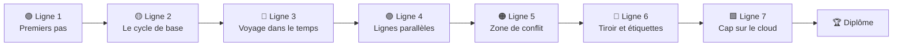

<div align="center">


<p>
  <a href="../README.md">🇧🇷 Português</a> ·
  <a href="README.en.md">🇬🇧 English</a> ·
  <a href="README.es.md">🇪🇸 Español</a> ·
  <b>🇫🇷 Français</b> ·
  <a href="README.de.md">🇩🇪 Deutsch</a> ·
  <a href="README.it.md">🇮🇹 Italiano</a> ·
  <a href="README.ru.md">🇷🇺 Русский</a> ·
  <a href="README.hi.md">🇮🇳 हिन्दी</a>
</p>

# 🚇 Git Quest

### Apprenez Git en **jouant**. Tapez de vraies commandes, gagnez des stations et rejoignez le cloud.

<p>
  
  
  
  
  
  
</p>

<a href="https://gitquestgame.vercel.app/"></a>
<a href="https://bruno-a-dias.github.io/git-quest/"></a>

</div>

---

## 🔗 Jouer maintenant

| Où | Lien |
|---|---|
| 🟣 **Vercel** (principal) | [gitquestgame.vercel.app](https://gitquestgame.vercel.app/) |
| ⚫ **GitHub Pages** (miroir) | [bruno-a-dias.github.io/git-quest](https://bruno-a-dias.github.io/git-quest/) |

Les deux adresses servent exactement les mêmes fichiers. Si l’une est en panne, utilisez l’autre.

---

## 🎮 De quoi s’agit-il ?

**Git Quest** est un jeu dans le navigateur qui enseigne Git de zéro jusqu’à `git push`. Pas de diapositives pleines de commandes : l’élève reçoit une **histoire** (vous venez d’être embauché par la *Pizzaria do Zé*), un **objectif** et un **terminal simulé** où il tape de vraies commandes. Le jeu vérifie le résultat, donne de l’XP, fait monter de niveau et débloque la station suivante.

> 💡 **Rien n’est installé et rien n’est écrit sur votre ordinateur.** Tout Git tourne dans la page, grâce à un moteur écrit en JavaScript pur. Se tromper ne coûte rien, et c’est ainsi qu’on apprend.

| 🕹️ Vous | 🧠 Le jeu |
|---|---|
| Tapez `git add .` et `git commit -m "..."` | Met à jour les 4 zones de Git **animées** à côté du terminal |
| Créez une branche et fusionnez-la | Dessine la **carte des commits** avec branches, tags et `HEAD` |
| Provoquez (et résolvez) un conflit | Affiche les marqueurs `<<<<<<<` exactement comme le vrai Git |
| Demandez de l’aide : **Indice 1 → Indice 2 → Voir la solution** | Réduit l’XP, mais ne laisse jamais l’élève bloqué |

---

## 🗺️ La carte du jeu : 9 lignes de métro

Chaque **monde est une ligne** et chaque **mission est une station** (les losanges sont des quiz). L’élève ne passe à la station suivante qu’après avoir terminé la précédente.



| Ligne | Thème | Ce que l’élève apprend | Missions |
|:--:|---|---|:--:|
| 🟢 **1** | Premiers pas | `git config`, `mkdir`, `cd`, `git init` | 3 |
| 🟡 **2** | Le cycle de base | `touch`/`echo`, `git add`, `git commit`, les zones de Git | 5 |
| 🔴 **3** | Voyage dans le temps | `git log`, `git diff`, `restore`, `commit --amend`, `revert`, `reflog` | 8 |
| 🟣 **4** | Lignes parallèles | `git branch`, `git switch`, `git merge`, supprimer des branches | 5 |
| 🟠 **5** | Zone de conflit | Conflits de merge et lecture des marqueurs | 2 |
| 🔵 **6** | Tiroir et étiquettes | `git stash`, `git tag` | 3 |
| 🟩 **7** | Cap sur le cloud | `git remote`, `push -u`, `pull`, `clone`, **boss final** | 6 |

**40 missions au total** : 33 de commande (3 sur le vrai GitHub) et 7 quiz éclair.

Les lignes 8 et 9 ajoutent du **Git avancé** (`rebase`, `bisect`, `worktree`) et des **missions sur le vrai GitHub** (créer un dépôt, fork, Pull Request, vérifiés par l’API publique de GitHub). En chemin, on gagne **14 trophées façon PlayStation** (bronze, argent, or, platine), affichés au verso du diplôme à côté des parcours. Le jeu fonctionne aussi **hors ligne** (PWA).

---

## ✨ Des fonctionnalités qui captent l’attention

- 🖥️ **Un terminal qui semble réel** : historique ↑ ↓, `Tab` complète commandes et fichiers, raccourcis cliquables et suggestion de commande en cas de faute de frappe.
- 🧩 **Les 4 zones de Git, animées** : dossier de travail → staging → dépôt → distant. Les fichiers « volent » d’une zone à l’autre à chaque `add`, `commit` et `push`.
- 🌿 **Carte des commits en direct** : un graphe façon plan de métro avec branches, tags, `HEAD` et le distant, mis à jour après chaque commande.
- ⚡ **XP, combo et rangs** : six niveaux, de *Stagiaire des commits* à *Maître du Git*. Les missions enchaînées sans indice allument le combo.
- 🏅 **Succès** : *Premier commit*, *Voyageur du temps*, *Chasseur de conflits*, *Maître du tiroir*, *La tête dans les nuages*, *Cloneur*, *Boss vaincu* et *Sans béquilles*.
- 💡 **Indices en trois étapes** : Indice 1, Indice 2 et Voir la solution (chaque ligne de la solution est cliquable et tombe dans le terminal).
- 🎉 **Confettis, sons et notifications** (le son est coupé au départ ; l’élève l’active s’il veut).
- 🎓 **Diplôme final** avec le nom de l’élève, l’XP, le titre et les succès, prêt pour une capture d’écran.
- 💾 **Progression sauvegardée** dans le navigateur, avec un bouton pour tout recommencer.
- 🌍 **8 langues en un clic** (drapeaux en haut) : missions, indices, quiz, succès et même les messages du terminal sont traduits, et le choix est mémorisé.
- 📱 **Responsive** : fonctionne sur téléphone et respecte `prefers-reduced-motion`.

<div align="center">

| Merge et carte des commits | Résolution d’un conflit |
|:--:|:--:|
|  |  |

| Cap sur le cloud (push) | Quiz éclair | Sur téléphone |
|:--:|:--:|:--:|
|  |  |  |

| 🇮🇳 En hindi | 🇩🇪 En allemand |
|:--:|:--:|
|  |  |

</div>

---

## 🌍 Langues

| | Langue | | Langue |
|:--:|---|:--:|---|
| 🇧🇷 | Português | 🇮🇳 | हिन्दी (Hindi) |
| 🇬🇧 | English | 🇷🇺 | Русский |
| 🇪🇸 | Español | 🇮🇹 | Italiano |
| 🇫🇷 | Français | 🇩🇪 | Deutsch |

Les drapeaux du jeu sont des **SVG dessinés à la main** (les emoji de drapeau ne s’affichent pas sous Windows). La langue initiale suit celle du navigateur et le choix de l’élève est sauvegardé.

**Envie d’ajouter une autre langue ?** Copiez `js/lang/en.js` vers `js/lang/xx.js`, traduisez-le, ajoutez le drapeau dans la liste `LANGS` de `js/i18n.js` et la balise `<script>` dans `index.html`. `npm test` vérifie qu’il ne manque rien.

> Les commandes (`git commit`, `git switch -c`…) ne sont jamais traduites, car l’élève doit taper la vraie commande. La sortie de Git reste en anglais, comme dans le vrai Git.

---

## 🧰 Commandes prises en charge par le simulateur

**Git (33):** `config` · `init` · `status` · `add` · `commit` · `log` · `show` · `diff` · `restore` · `reset` · `revert` · `rm` · `mv` · `clean` · `branch` · `switch` · `checkout` · `merge` · `cherry-pick` · `rebase` · `bisect` · `worktree` · `stash` · `tag` · `remote` · `push` · `fetch` · `pull` · `clone` · `reflog` · `ls-files` · `rev-parse` · `help`

**Shell:** `ls` · `cat` · `touch` · `echo` (`>` / `>>`) · `mkdir` · `cd` · `pwd` · `rm` · `clear`

Il comprend aussi `HEAD~n`, `HEAD^`, `HEAD@{n}`, `.gitignore`, les alias (`git config alias.*`) et de vrais conflits de merge (à trois voies, avec marqueurs).

---

## 🧑‍🏫 Pour les enseignants

Pensé pour la salle de classe :

- 🔓 **Mode enseignant :** ouvrez la page avec `#professor` à la fin de l’adresse (`https://gitquestgame.vercel.app/#professor`) pour débloquer toutes les missions, idéal pour des démonstrations en direct.
- 📖 Chaque mission indique la **partie du guide** correspondante (Parties 1 à 14), pour faire correspondre le jeu au support de référence.
- 🔁 À utiliser comme **échauffement** (10 minutes), **travaux pratiques** ou **devoir à la maison** : la progression est sauvegardée dans le navigateur de chaque élève.
- 🔒 Pas de connexion, pas de serveur, aucune collecte de données. Il suffit d’héberger les fichiers statiques (GitHub Pages, Vercel, Netlify ou une clé USB).
- 🧪 Les 26 missions de commande ont une **solution testée automatiquement** dans toutes les langues (`npm test`), donc aucune station n’est impossible.
- 📊 **Tableau de bord de la classe :** chaque élève clique sur **Progression** et vous envoie le code ; collez le tout dans [`professor.html`](https://gitquestgame.vercel.app/professor.html) pour voir le classement, qui a terminé et où la classe bloque, avec export CSV. Le diplôme se télécharge en **image PNG** avec un code de vérification qui apparaît aussi dans le tableau.

> **Idée de cours :** projetez le jeu, jouez la Ligne 1 avec la classe, puis laissez chacun avancer à son rythme. Celui qui termine en premier génère le diplôme et aide ses camarades.

---

## 🛠️ Lancer en local

Pas de build, pas de bundler, pas de `npm install`. Ce sont des fichiers statiques.

```bash
git clone https://github.com/bruno-a-dias/git-quest.git
cd git-quest

# option 1 : ouvrir directement dans le navigateur
open index.html            # macOS  (Linux: xdg-open · Windows: start)

# option 2 : serveur local
npx serve .                # python3 -m http.server 8080
```

### ✅ Tests (Node 18+)

```bash
npm test
```

Lance trois suites : celle du **moteur Git** (plus de 100 vérifications de commandes et de messages), celle des **missions** (chaque solution est exécutée et tous les objectifs doivent être atteints) et celle des **langues** (chaque traduction doit contenir les 32 missions, les textes et les succès, et les commandes citées dans les indices ne doivent pas avoir changé).

### 🌐 Publier sur GitHub Pages

1. Envoyez le dépôt sur GitHub.
2. Allez dans **Settings → Pages**.
3. Dans *Build and deployment*, choisissez **Deploy from a branch**, branche `main` et dossier `/ (root)`.
4. En quelques minutes, le jeu sera sur `https://bruno-a-dias.github.io/git-quest/`.
5. (Facultatif) **Vercel :** importez le dépôt sur [vercel.com/new](https://vercel.com/new), laissez *Framework Preset* sur **Other** et sans commande de build. La version officielle de ce projet est sur `https://gitquestgame.vercel.app/`.

---

## 🧱 Comment ça marche à l’intérieur

```
git-quest/
├── index.html              # structure de la page et ordre des scripts
├── css/
│   └── style.css           # style « plan de métro sur papier quadrillé sombre »
├── js/
│   ├── git-engine.js       # moteur Git + mini shell (JS pur, sans dépendances)
│   ├── missions.js         # mondes, missions, quiz, rangs et succès (les DONNÉES, en portugais)
│   ├── i18n.js             # moteur de langues + drapeaux SVG
│   ├── lang/               # un fichier par langue : en, es, fr, de, it, ru, hi
│   ├── core.js             # préparation de la mission et évaluation des objectifs
│   ├── ui-panels.js        # HUD, plan des lignes, zones de Git, graphe, sons, confettis
│   └── ui-game.js          # terminal, déroulement des missions, indices, diplôme, démarrage
├── tests/                  # tests du moteur, des missions et des langues
├── i18n/                   # ce README dans d’autres langues
├── docs/                   # captures d’écran utilisées dans les README
├── package.json
├── LICENSE
└── README.md
```

Les scripts sont classiques (sans modules) et **chargés dans cet ordre**, car ils partagent la portée globale :

```html
<script src="js/git-engine.js"></script>
<script src="js/missions.js"></script>
<script src="js/i18n.js"></script>
<script src="js/lang/en.js"></script>   <!-- ... -->
<script src="js/core.js"></script>
<script src="js/ui-panels.js"></script>
<script src="js/ui-game.js"></script>
```

### 🔬 Le moteur Git

Un dépôt n’est qu’un objet JavaScript : `{ head, branches, commits, index, stash, tags, remotes, server, reflog… }`. Chaque commande lit et modifie ce modèle puis renvoie des lignes colorées pour le terminal. Il y a un `diff` basé sur la LCS, un `merge` à trois voies avec détection de conflits, `reflog`, `stash` et un « serveur » simulé pour `push`, `fetch`, `pull` et `clone`. Le résultat est fidèle au vrai Git dans les cas utilisés en cours.

### 🎯 Comment une mission est définie

Ajouter une station revient à ajouter un objet dans `js/missions.js` (le texte de base est en portugais) et sa traduction dans chaque fichier `js/lang/*.js` :

```js
{
  w: 3,                          // indice du monde (ligne)
  title: 'Abrindo uma linha paralela',
  doc: 'Parte 8',
  story: '...',
  setup: BASE,                   // commandes silencieuses qui préparent le scénario
  goals: [                       // objectifs vérifiés, pas seulement « bien tapé »
    { t: 'Criar a branch feature/sabores', ok: (g, ctx) => /* ... */ },
  ],
  hints: ['...', '...'],
  solution: ['git switch -c feature/sabores'],
  learn: '...'
}
```

Les objectifs regardent l’**état du dépôt** (`ok(g, ctx)`), donc tout chemin correct fonctionne : `git switch -c`, `git checkout -b` ou `git branch` + `git switch`.

### 🧮 Score

| Situation | XP |
|---|:--:|
| Mission de commande (sans indice) | **100** |
| Chaque indice utilisé | −25 (min 20) |
| Bonus : sans erreur **et** sans indice | **+25** |
| Quiz au 1er / 2e / 3e essai ou plus | **50 / 25 / 10** |

Les rangs montent à des fractions du total d’XP possible, donc le parcours garde le même rythme même si de nouvelles missions sont ajoutées.

---

## 🤝 Contribuer

Des idées qui seraient super :

- [ ] Un monde en plus avec `rebase`, `bisect` et `git worktree`
- [ ] Mode défi chronométré
- [ ] Classement de la classe (export/import de la progression dans un fichier)
- [ ] Plus de langues (japonais, arabe, chinois…)
- [ ] De nouveaux scénarios en plus de la *Pizzaria do Zé*

Ouvrez une *issue* avec votre idée ou envoyez une *pull request*. Lancez d’abord `npm test`.


<h2 align="center">Les héros de Git Quest 🛡️</h2>

<table align="center" style="background-color: #121212; border-radius: 10px; border: none;">
  <tr>
    <!-- Card do Criador (Bruno) -->
    <td align="center" width="220" style="padding: 15px; border: 1px solid #FFD700; border-radius: 8px;">
      <a href="https://github.com/bruno-a-dias">
        <br />
        <br />
        <sub><b style="font-size: 16px; color: #FFFFFF;">Bruno Assunção Dias</b></sub>
      </a><br />
      <span style="color: #FFD700; font-weight: bold;">👑 Créateur / Mainteneur</span><br />
      <sub style="color: #A0A0A0;">DevQuest / Git Quest</sub>
    </td>

    <!-- NOVO_CONTRIBUIDOR_AQUI -->

  </tr>
</table>

---

## 👨‍🏫 Auteur

**Prof. Me. Bruno Assunção Dias** · Professeur de technologies de l’information à l’**IESB**, Brasília-DF, Brésil.
GitHub: [@bruno-a-dias](https://github.com/bruno-a-dias)

Fait avec ☕ et beaucoup de `git commit` pour que les élèves **n’aient plus peur du terminal**.

## 📄 Licence

Distribué sous licence **MIT**. Voir [`LICENSE`](../LICENSE). Utilisez-le, adaptez-le et emmenez-le dans votre classe.

<div align="center">

⭐ Si Git Quest a aidé votre classe, laissez une étoile sur le dépôt !

</div>
