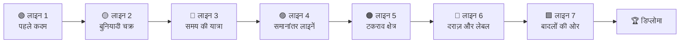

<div align="center">


<p>
  <a href="../README.md">🇧🇷 Português</a> ·
  <a href="README.en.md">🇬🇧 English</a> ·
  <a href="README.es.md">🇪🇸 Español</a> ·
  <a href="README.fr.md">🇫🇷 Français</a> ·
  <a href="README.de.md">🇩🇪 Deutsch</a> ·
  <a href="README.it.md">🇮🇹 Italiano</a> ·
  <a href="README.ru.md">🇷🇺 Русский</a> ·
  <b>🇮🇳 हिन्दी</b>
</p>

# 🚇 Git Quest

### **खेलते हुए** Git सीखें। असली कमांड लिखें, स्टेशन जीतें और बादलों तक पहुँचें।

<p>
  
  
  
  
  
  
</p>

<a href="https://gitquestgame.vercel.app/"></a>
<a href="https://bruno-a-dias.github.io/git-quest/"></a>

</div>

---

## 🔗 अभी खेलें

| कहाँ | लिंक |
|---|---|
| 🟣 **Vercel** (मुख्य) | [gitquestgame.vercel.app](https://gitquestgame.vercel.app/) |
| ⚫ **GitHub Pages** (मिरर) | [bruno-a-dias.github.io/git-quest](https://bruno-a-dias.github.io/git-quest/) |

दोनों पते बिल्कुल एक ही फ़ाइलें देते हैं। एक बंद हो तो दूसरा इस्तेमाल करें।

---

## 🎮 यह क्या है?

**Git Quest** ब्राउज़र में चलने वाला खेल है जो Git को शून्य से `git push` तक सिखाता है। कमांडों से भरी स्लाइड नहीं: विद्यार्थी को एक **कहानी** मिलती है (आपको अभी-अभी *Pizzaria do Zé* ने नियुक्त किया है), एक **लक्ष्य** और एक **नकली टर्मिनल** जिसमें असली कमांड लिखे जाते हैं। खेल नतीजा जाँचता है, XP देता है, स्तर बढ़ाता है और अगला स्टेशन खोलता है।

> 💡 **कुछ इंस्टॉल नहीं होता और आपके कंप्यूटर पर कुछ नहीं लिखा जाता।** पूरा Git पेज के अंदर, शुद्ध JavaScript में लिखे इंजन पर चलता है। ग़लती करना मुफ़्त है, और इसी तरह सीखा जाता है।

| 🕹️ आप | 🧠 खेल |
|---|---|
| `git add .` और `git commit -m "..."` लिखते हैं | टर्मिनल के बगल में Git के 4 **एनिमेटेड** क्षेत्र अपडेट करता है |
| ब्रांच बनाते हैं और मर्ज करते हैं | ब्रांच, टैग और `HEAD` के साथ **कमिट का नक्शा** बनाता है |
| टकराव पैदा करते हैं (और सुलझाते हैं) | असली Git की तरह `<<<<<<<` चिह्न दिखाता है |
| मदद माँगते हैं: **संकेत 1 → संकेत 2 → हल देखें** | XP घटाता है, पर विद्यार्थी को कभी अटकने नहीं देता |

---

## 🗺️ खेल का नक्शा: 7 मेट्रो लाइनें

हर **दुनिया एक लाइन** है और हर **मिशन एक स्टेशन** (हीरे के आकार वाले क्विज़ हैं)। विद्यार्थी मौजूदा स्टेशन पूरा करने के बाद ही अगले पर जा सकता है।



| लाइन | विषय | क्या सीखते हैं | मिशन |
|:--:|---|---|:--:|
| 🟢 **1** | पहले कदम | `git config`, `mkdir`, `cd`, `git init` | 3 |
| 🟡 **2** | बुनियादी चक्र | `touch`/`echo`, `git add`, `git commit`, Git के क्षेत्र | 5 |
| 🔴 **3** | समय की यात्रा | `git log`, `git diff`, `restore`, `commit --amend`, `revert`, `reflog` | 8 |
| 🟣 **4** | समानांतर लाइनें | `git branch`, `git switch`, `git merge`, ब्रांच हटाना | 5 |
| 🟠 **5** | टकराव क्षेत्र | मर्ज के टकराव और चिह्न पढ़ना | 2 |
| 🔵 **6** | दराज़ और लेबल | `git stash`, `git tag` | 3 |
| 🟩 **7** | बादलों की ओर | `git remote`, `push -u`, `pull`, `clone`, **अंतिम बॉस** | 6 |

**कुल 32 मिशन**: 26 कमांड वाले और 6 झटपट क्विज़।

---

## ✨ जो ध्यान बाँधे रखें

- 🖥️ **असली जैसा टर्मिनल**: ↑ ↓ से इतिहास, `Tab` से कमांड और फ़ाइलें पूरी होती हैं, क्लिक करने योग्य शॉर्टकट, और कमांड ग़लत लिखने पर सुझाव।
- 🧩 **Git के 4 क्षेत्र, एनिमेशन के साथ**: कार्य फ़ोल्डर → स्टेजिंग → रिपॉज़िटरी → रिमोट। हर `add`, `commit` और `push` पर फ़ाइलें एक क्षेत्र से दूसरे में "उड़ती" हैं।
- 🌿 **सीधा कमिट का नक्शा**: ब्रांच, टैग, `HEAD` और रिमोट के साथ मेट्रो-शैली का ग्राफ़, हर कमांड के बाद अपडेट।
- ⚡ **XP, कॉम्बो और रैंक**: छह स्तर, *कमिट प्रशिक्षु* से *Git गुरु* तक। बिना संकेत लगातार मिशन करने पर कॉम्बो जलता है।
- 🏅 **उपलब्धियाँ**: *पहला कमिट*, *समय यात्री*, *टकराव शिकारी*, *दराज़ का उस्ताद*, *बादलों में सिर*, *क्लोनर*, *बॉस हारा* और *बिना बैसाखी*।
- 💡 **तीन सीढ़ियों में संकेत**: संकेत 1, संकेत 2 और हल देखें (हल की हर पंक्ति क्लिक करने योग्य है और सीधे टर्मिनल में गिरती है)।
- 🎉 **कॉन्फ़ेटी, ध्वनि और सूचनाएँ** (ध्वनि शुरू में बंद रहती है; चाहें तो विद्यार्थी चालू करे)।
- 🎓 **अंतिम डिप्लोमा** जिसमें विद्यार्थी का नाम, XP, उपाधि और उपलब्धियाँ हैं, स्क्रीनशॉट के लिए तैयार।
- 💾 **प्रगति सहेजी जाती है** ब्राउज़र में, और फिर से शुरू करने का बटन भी है।
- 🌍 **एक क्लिक में 8 भाषाएँ** (ऊपर झंडे): मिशन, संकेत, क्विज़, उपलब्धियाँ और टर्मिनल के संदेश तक अनूदित हैं, और चुनाव याद रखा जाता है।
- 📱 **रिस्पॉन्सिव**: फ़ोन पर चलता है और `prefers-reduced-motion` का सम्मान करता है।

<div align="center">

| मर्ज और कमिट का नक्शा | टकराव सुलझाना |
|:--:|:--:|
|  |  |

| बादलों की ओर (push) | झटपट क्विज़ | फ़ोन पर |
|:--:|:--:|:--:|
|  |  |  |

| 🇮🇳 हिन्दी में | 🇩🇪 जर्मन में |
|:--:|:--:|
|  |  |

</div>

---

## 🌍 भाषाएँ

| | भाषा | | भाषा |
|:--:|---|:--:|---|
| 🇧🇷 | Português | 🇮🇳 | हिन्दी (Hindi) |
| 🇬🇧 | English | 🇷🇺 | Русский |
| 🇪🇸 | Español | 🇮🇹 | Italiano |
| 🇫🇷 | Français | 🇩🇪 | Deutsch |

खेल के झंडे **हाथ से बनाए SVG** हैं (Windows पर झंडे वाले इमोजी नहीं दिखते)। शुरुआती भाषा ब्राउज़र के अनुसार तय होती है और विद्यार्थी का चुनाव सहेजा जाता है।

**कोई और भाषा जोड़नी है?** `js/lang/en.js` को `js/lang/xx.js` में कॉपी करें, अनुवाद करें, `js/i18n.js` की `LANGS` सूची में झंडा और `index.html` में `<script>` टैग जोड़ें। `npm test` जाँच लेता है कि कुछ छूटा तो नहीं।

> कमांड (`git commit`, `git switch -c`…) का कभी अनुवाद नहीं होता, क्योंकि विद्यार्थी को असली कमांड लिखना है। Git का अपना आउटपुट अंग्रेज़ी में ही रहता है, असली Git की तरह।

---

## 🧰 सिम्युलेटर द्वारा समर्थित कमांड

**Git (30):** `config` · `init` · `status` · `add` · `commit` · `log` · `show` · `diff` · `restore` · `reset` · `revert` · `rm` · `mv` · `clean` · `branch` · `switch` · `checkout` · `merge` · `cherry-pick` · `stash` · `tag` · `remote` · `push` · `fetch` · `pull` · `clone` · `reflog` · `ls-files` · `rev-parse` · `help`

**Shell:** `ls` · `cat` · `touch` · `echo` (`>` / `>>`) · `mkdir` · `cd` · `pwd` · `rm` · `clear`

यह `HEAD~n`, `HEAD^`, `HEAD@{n}`, `.gitignore`, एलियास (`git config alias.*`) और असली मर्ज टकराव (तीन-तरफ़ा, चिह्नों के साथ) भी समझता है।

---

## 🧑‍🏫 शिक्षकों के लिए

कक्षा के लिए बनाया गया:

- 🔓 **शिक्षक मोड:** सभी मिशन खोलने के लिए पते के अंत में `#professor` लगाकर पेज खोलें (`https://gitquestgame.vercel.app/#professor`), किसी भी विषय के सीधे प्रदर्शन के लिए बढ़िया।
- 📖 हर मिशन गाइड के संबंधित **भाग** (भाग 1 से 14) का संकेत देता है, ताकि खेल संदर्भ सामग्री से मेल खाए।
- 🔁 इसे **वार्म-अप** (10 मिनट), **प्रयोगशाला** या **गृहकार्य** के रूप में इस्तेमाल करें: प्रगति हर विद्यार्थी के ब्राउज़र में सहेजी रहती है।
- 🔒 न लॉगिन, न सर्वर, न डेटा संग्रह। बस स्थिर फ़ाइलें होस्ट करें (GitHub Pages, Vercel, Netlify या पेनड्राइव)।
- 🧪 26 कमांड मिशनों का **हल स्वचालित रूप से परखा गया** है, सभी भाषाओं में (`npm test`), इसलिए कोई स्टेशन असंभव नहीं है।

> **कक्षा का विचार:** खेल को प्रोजेक्टर पर दिखाएँ, कक्षा के साथ लाइन 1 खेलें, फिर हर विद्यार्थी को अपनी गति से बढ़ने दें। जो पहले पूरा करे वह डिप्लोमा बनाए और साथियों की मदद करे।

---

## 🛠️ स्थानीय रूप से चलाएँ

न बिल्ड, न बंडलर, न `npm install`। बस स्थिर फ़ाइलें।

```bash
git clone https://github.com/bruno-a-dias/git-quest.git
cd git-quest

# विकल्प 1: सीधे ब्राउज़र में खोलें
open index.html            # macOS  (Linux: xdg-open · Windows: start)

# विकल्प 2: स्थानीय सर्वर
npx serve .                # python3 -m http.server 8080
```

### ✅ टेस्ट (Node 18+)

```bash
npm test
```

तीन सूट चलते हैं: **Git इंजन** (100 से अधिक कमांड और संदेश जाँचें), **मिशन** (हर मिशन का हल चलाया जाता है और सभी लक्ष्य पूरे होने चाहिए) और **भाषाएँ** (हर अनुवाद में सभी 32 मिशन, पाठ और उपलब्धियाँ होनी चाहिए, और संकेतों में दिए कमांड बदले नहीं होने चाहिए)।

### 🌐 GitHub Pages पर प्रकाशित करें

1. रिपॉज़िटरी GitHub पर भेजें।
2. **Settings → Pages** पर जाएँ।
3. *Build and deployment* में **Deploy from a branch**, ब्रांच `main` और फ़ोल्डर `/ (root)` चुनें।
4. कुछ मिनट में खेल `https://bruno-a-dias.github.io/git-quest/` पर उपलब्ध होगा।
5. (वैकल्पिक) **Vercel:** [vercel.com/new](https://vercel.com/new) पर रिपॉज़िटरी इम्पोर्ट करें, *Framework Preset* को **Other** रखें और बिल्ड कमांड खाली छोड़ें। इस प्रोजेक्ट का आधिकारिक संस्करण `https://gitquestgame.vercel.app/` पर है।

---

## 🧱 अंदर से यह कैसे काम करता है

```
git-quest/
├── index.html              # पेज की संरचना और स्क्रिप्ट का क्रम
├── css/
│   └── style.css           # "गहरे ग्राफ़ पेपर पर मेट्रो नक्शा" शैली
├── js/
│   ├── git-engine.js       # Git इंजन + मिनी शेल (शुद्ध JS, बिना निर्भरता)
│   ├── missions.js         # दुनिया, मिशन, क्विज़, रैंक और उपलब्धियाँ (डेटा, पुर्तगाली में)
│   ├── i18n.js             # भाषा इंजन + SVG झंडे
│   ├── lang/               # हर भाषा की एक फ़ाइल: en, es, fr, de, it, ru, hi
│   ├── core.js             # मिशन की तैयारी और लक्ष्यों का मूल्यांकन
│   ├── ui-panels.js        # HUD, लाइनों का नक्शा, Git क्षेत्र, ग्राफ़, ध्वनि, कॉन्फ़ेटी
│   └── ui-game.js          # टर्मिनल, मिशन का प्रवाह, संकेत, डिप्लोमा, शुरुआत
├── tests/                  # इंजन, मिशन और भाषाओं के टेस्ट
├── i18n/                   # यह README अन्य भाषाओं में
├── docs/                   # README में इस्तेमाल हुए स्क्रीनशॉट
├── package.json
├── LICENSE
└── README.md
```

स्क्रिप्ट सामान्य हैं (मॉड्यूल नहीं) और **इसी क्रम में लोड होती हैं**, क्योंकि वे वैश्विक स्कोप साझा करती हैं:

```html
<script src="js/git-engine.js"></script>
<script src="js/missions.js"></script>
<script src="js/i18n.js"></script>
<script src="js/lang/en.js"></script>   <!-- ... -->
<script src="js/core.js"></script>
<script src="js/ui-panels.js"></script>
<script src="js/ui-game.js"></script>
```

### 🔬 Git इंजन

रिपॉज़िटरी बस एक JavaScript ऑब्जेक्ट है: `{ head, branches, commits, index, stash, tags, remotes, server, reflog… }`। हर कमांड उस मॉडल को पढ़ता और बदलता है और टर्मिनल के लिए रंगीन पंक्तियाँ लौटाता है। LCS पर आधारित `diff`, टकराव पहचानने वाला तीन-तरफ़ा `merge`, `reflog`, `stash` और `push`, `fetch`, `pull` व `clone` के लिए नकली "सर्वर" है। कक्षा में काम आने वाले मामलों में नतीजा असली Git से मेल खाता है।

### 🎯 मिशन कैसे परिभाषित होता है

स्टेशन जोड़ना यानी `js/missions.js` में एक ऑब्जेक्ट जोड़ना (मूल पाठ पुर्तगाली में है) और उसका अनुवाद हर `js/lang/*.js` फ़ाइल में डालना:

```js
{
  w: 3,                          // दुनिया (लाइन) का सूचकांक
  title: 'Abrindo uma linha paralela',
  doc: 'Parte 8',
  story: '...',
  setup: BASE,                   // चुपचाप चलने वाले कमांड जो परिदृश्य तैयार करते हैं
  goals: [                       // जाँचे जाने वाले लक्ष्य, सिर्फ़ "सही लिखा" नहीं
    { t: 'Criar a branch feature/sabores', ok: (g, ctx) => /* ... */ },
  ],
  hints: ['...', '...'],
  solution: ['git switch -c feature/sabores'],
  learn: '...'
}
```

लक्ष्य **रिपॉज़िटरी की स्थिति** देखते हैं (`ok(g, ctx)`), इसलिए कोई भी सही रास्ता चलता है: `git switch -c`, `git checkout -b` या `git branch` + `git switch`।

### 🧮 अंक प्रणाली

| स्थिति | XP |
|---|:--:|
| कमांड मिशन (बिना संकेत) | **100** |
| हर इस्तेमाल किया संकेत | −25 (min 20) |
| बोनस: बिना ग़लती **और** बिना संकेत | **+25** |
| क्विज़ पहली / दूसरी / तीसरी+ कोशिश पर | **50 / 25 / 10** |

रैंक कुल संभव XP के अंशों पर बढ़ते हैं, इसलिए नए मिशन जुड़ने पर भी सफ़र की गति वैसी ही रहती है।

---

## 🤝 योगदान

ऐसे विचार जो शानदार होंगे:

- [ ] `rebase`, `bisect` और `git worktree` वाली अतिरिक्त दुनिया
- [ ] समय-सीमा वाला चुनौती मोड
- [ ] कक्षा का स्कोरबोर्ड (प्रगति को फ़ाइल में एक्सपोर्ट/इम्पोर्ट करना)
- [ ] और भाषाएँ (जापानी, अरबी, चीनी…)
- [ ] *Pizzaria do Zé* के अलावा नए परिदृश्य

अपने विचार के साथ *issue* खोलें या *pull request* भेजें। पहले `npm test` चलाएँ।

---

## 👨‍🏫 लेखक

**Prof. Me. Bruno Assunção Dias** · **IESB**, ब्रासीलिया-DF, ब्राज़ील में सूचना प्रौद्योगिकी के प्रोफ़ेसर।
GitHub: [@bruno-a-dias](https://github.com/bruno-a-dias)

☕ और ढेर सारे `git commit` के साथ बनाया गया, ताकि विद्यार्थी **टर्मिनल से डरना छोड़ दें**।

## 📄 लाइसेंस

**MIT** लाइसेंस के तहत जारी। [`LICENSE`](../LICENSE) देखें। इस्तेमाल करें, अपने हिसाब से बदलें और अपनी कक्षा में ले जाएँ।

<div align="center">

⭐ अगर Git Quest ने आपकी कक्षा की मदद की, तो रिपॉज़िटरी को एक स्टार दें!

</div>
