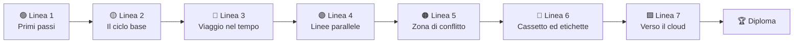

<div align="center">


<p>
  <a href="../README.md">🇧🇷 Português</a> ·
  <a href="README.en.md">🇬🇧 English</a> ·
  <a href="README.es.md">🇪🇸 Español</a> ·
  <a href="README.fr.md">🇫🇷 Français</a> ·
  <a href="README.de.md">🇩🇪 Deutsch</a> ·
  <b>🇮🇹 Italiano</b> ·
  <a href="README.ru.md">🇷🇺 Русский</a> ·
  <a href="README.hi.md">🇮🇳 हिन्दी</a>
</p>

# 🚇 Git Quest

### Impara Git **giocando**. Scrivi comandi veri, conquista stazioni e arriva al cloud.

<p>
  
  
  
  
  
  
</p>

<a href="https://gitquestgame.vercel.app/"></a>
<a href="https://bruno-a-dias.github.io/git-quest/"></a>

</div>

---

## 🔗 Gioca ora

| Dove | Link |
|---|---|
| 🟣 **Vercel** (principale) | [gitquestgame.vercel.app](https://gitquestgame.vercel.app/) |
| ⚫ **GitHub Pages** (mirror) | [bruno-a-dias.github.io/git-quest](https://bruno-a-dias.github.io/git-quest/) |

I due indirizzi servono esattamente gli stessi file. Se uno non funziona, usa l’altro.

---

## 🎮 Che cos’è?

**Git Quest** è un gioco nel browser che insegna Git da zero fino a `git push`. Niente slide piene di comandi: lo studente riceve una **storia** (sei appena stato assunto dalla *Pizzaria do Zé*), un **obiettivo** e un **terminale simulato** dove scrive i comandi veri. Il gioco controlla il risultato, assegna XP, fa salire di livello e sblocca la stazione successiva.

> 💡 **Non si installa nulla e non viene scritto nulla sul tuo computer.** Tutto Git gira dentro la pagina, in un motore scritto in JavaScript puro. Sbagliare non costa niente, ed è così che si impara.

| 🕹️ Tu | 🧠 Il gioco |
|---|---|
| Scrivi `git add .` e `git commit -m "..."` | Aggiorna le 4 aree di Git **animate** accanto al terminale |
| Crei un branch e lo unisci | Disegna la **mappa dei commit** con branch, tag e `HEAD` |
| Provochi (e risolvi) un conflitto | Mostra i marcatori `<<<<<<<` esattamente come il vero Git |
| Chiedi aiuto: **Suggerimento 1 → Suggerimento 2 → Mostra la soluzione** | Riduce gli XP, ma non lascia mai lo studente bloccato |

---

## 🗺️ La mappa del gioco: 7 linee di metro

Ogni **mondo è una linea** e ogni **missione è una stazione** (quelle a rombo sono quiz). Lo studente avanza alla stazione successiva solo dopo aver completato quella attuale.



| Linea | Tema | Cosa si impara | Missioni |
|:--:|---|---|:--:|
| 🟢 **1** | Primi passi | `git config`, `mkdir`, `cd`, `git init` | 3 |
| 🟡 **2** | Il ciclo base | `touch`/`echo`, `git add`, `git commit`, le aree di Git | 5 |
| 🔴 **3** | Viaggio nel tempo | `git log`, `git diff`, `restore`, `commit --amend`, `revert`, `reflog` | 8 |
| 🟣 **4** | Linee parallele | `git branch`, `git switch`, `git merge`, eliminare branch | 5 |
| 🟠 **5** | Zona di conflitto | Conflitti di merge e lettura dei marcatori | 2 |
| 🔵 **6** | Cassetto ed etichette | `git stash`, `git tag` | 3 |
| 🟩 **7** | Verso il cloud | `git remote`, `push -u`, `pull`, `clone`, **boss finale** | 6 |

**32 missioni in totale**: 26 di comando e 6 quiz lampo.

---

## ✨ Funzioni che tengono alta l’attenzione

- 🖥️ **Un terminale che sembra vero**: cronologia con ↑ ↓, `Tab` completa comandi e file, scorciatoie cliccabili e suggerimento quando sbagli a scrivere un comando.
- 🧩 **Le 4 aree di Git, animate**: cartella di lavoro → staging → repository → remoto. I file «volano» da un’area all’altra a ogni `add`, `commit` e `push`.
- 🌿 **Mappa dei commit in tempo reale**: un grafo in stile mappa del metro con branch, tag, `HEAD` e remoto, aggiornato a ogni comando.
- ⚡ **XP, combo e gradi**: sei livelli, da *Stagista dei commit* a *Maestro di Git*. Le missioni di fila senza suggerimenti accendono la combo.
- 🏅 **Traguardi**: *Primo commit*, *Viaggiatore del tempo*, *Cacciatore di conflitti*, *Maestro del cassetto*, *Testa tra le nuvole*, *Clonatore*, *Boss sconfitto* e *Senza stampelle*.
- 💡 **Suggerimenti in tre gradini**: Suggerimento 1, Suggerimento 2 e Mostra la soluzione (ogni riga della soluzione è cliccabile e finisce nel terminale).
- 🎉 **Coriandoli, suoni e notifiche** (l’audio parte spento; lo studente lo attiva se vuole).
- 🎓 **Diploma finale** con nome, XP, titolo e traguardi, pronto per lo screenshot.
- 💾 **Progressi salvati** nel browser, con un pulsante per ricominciare.
- 🌍 **8 lingue con un clic** (bandiere in alto): missioni, suggerimenti, quiz, traguardi e perfino i messaggi del terminale sono tradotti, e la scelta viene ricordata.
- 📱 **Responsive**: funziona sul telefono e rispetta `prefers-reduced-motion`.

<div align="center">

| Merge e mappa dei commit | Risolvere un conflitto |
|:--:|:--:|
|  |  |

| Verso il cloud (push) | Quiz lampo | Sul telefono |
|:--:|:--:|:--:|
|  |  |  |

| 🇮🇳 In hindi | 🇩🇪 In tedesco |
|:--:|:--:|
|  |  |

</div>

---

## 🌍 Lingue

| | Lingua | | Lingua |
|:--:|---|:--:|---|
| 🇧🇷 | Português | 🇮🇳 | हिन्दी (Hindi) |
| 🇬🇧 | English | 🇷🇺 | Русский |
| 🇪🇸 | Español | 🇮🇹 | Italiano |
| 🇫🇷 | Français | 🇩🇪 | Deutsch |

Le bandiere del gioco sono **SVG disegnati a mano** (le emoji delle bandiere non si vedono su Windows). La lingua iniziale segue quella del browser e la scelta dello studente viene salvata.

**Vuoi aggiungere un’altra lingua?** Copia `js/lang/en.js` in `js/lang/xx.js`, traducilo, aggiungi la bandiera all’elenco `LANGS` in `js/i18n.js` e il tag `<script>` in `index.html`. `npm test` controlla che non manchi nulla.

> I comandi (`git commit`, `git switch -c`…) non vengono mai tradotti, perché lo studente deve scrivere il comando vero. L’output di Git resta in inglese, come nel Git reale.

---

## 🧰 Comandi supportati dal simulatore

**Git (30):** `config` · `init` · `status` · `add` · `commit` · `log` · `show` · `diff` · `restore` · `reset` · `revert` · `rm` · `mv` · `clean` · `branch` · `switch` · `checkout` · `merge` · `cherry-pick` · `stash` · `tag` · `remote` · `push` · `fetch` · `pull` · `clone` · `reflog` · `ls-files` · `rev-parse` · `help`

**Shell:** `ls` · `cat` · `touch` · `echo` (`>` / `>>`) · `mkdir` · `cd` · `pwd` · `rm` · `clear`

Capisce anche `HEAD~n`, `HEAD^`, `HEAD@{n}`, `.gitignore`, gli alias (`git config alias.*`) e veri conflitti di merge (a tre vie, con marcatori).

---

## 🧑‍🏫 Per gli insegnanti

Pensato per l’aula:

- 🔓 **Modalità insegnante:** apri la pagina con `#professor` in fondo all’indirizzo (`https://gitquestgame.vercel.app/#professor`) per sbloccare tutte le missioni, ottimo per dimostrazioni dal vivo.
- 📖 Ogni missione indica la **parte della guida** corrispondente (Parti da 1 a 14), per abbinare il gioco al materiale di riferimento.
- 🔁 Usalo come **riscaldamento** (10 minuti), **laboratorio** o **compito a casa**: i progressi restano salvati nel browser di ogni studente.
- 🔒 Nessun login, nessun server, nessuna raccolta di dati. Basta ospitare i file statici (GitHub Pages, Vercel, Netlify o una chiavetta USB).
- 🧪 Le 26 missioni di comando hanno una **soluzione testata automaticamente** in tutte le lingue (`npm test`), quindi nessuna stazione è impossibile.

> **Idea di lezione:** proietta il gioco, giocate insieme la Linea 1 e poi lascia che ognuno proceda al proprio ritmo. Chi finisce per primo genera il diploma e aiuta i compagni.

---

## 🛠️ Eseguire in locale

Nessuna build, nessun bundler, nessun `npm install`. Solo file statici.

```bash
git clone https://github.com/bruno-a-dias/git-quest.git
cd git-quest

# opzione 1: aprire direttamente nel browser
open index.html            # macOS  (Linux: xdg-open · Windows: start)

# opzione 2: server locale
npx serve .                # python3 -m http.server 8080
```

### ✅ Test (Node 18+)

```bash
npm test
```

Esegue tre suite: quella del **motore Git** (oltre 100 controlli su comandi e messaggi), quella delle **missioni** (viene eseguita la soluzione di ciascuna e tutti gli obiettivi devono essere raggiunti) e quella delle **lingue** (ogni traduzione deve avere tutte le 32 missioni, i testi e i traguardi, e i comandi citati nei suggerimenti non devono essere cambiati).

### 🌐 Pubblicare su GitHub Pages

1. Invia il repository a GitHub.
2. Vai in **Settings → Pages**.
3. In *Build and deployment* scegli **Deploy from a branch**, branch `main` e cartella `/ (root)`.
4. In pochi minuti il gioco sarà su `https://bruno-a-dias.github.io/git-quest/`.
5. (Facoltativo) **Vercel:** importa il repository su [vercel.com/new](https://vercel.com/new), lascia *Framework Preset* su **Other** e senza comando di build. La versione ufficiale è su `https://gitquestgame.vercel.app/`.

---

## 🧱 Come funziona dentro

```
git-quest/
├── index.html              # struttura della pagina e ordine degli script
├── css/
│   └── style.css           # stile «mappa del metro su carta quadrettata scura»
├── js/
│   ├── git-engine.js       # motore Git + mini shell (JS puro, senza dipendenze)
│   ├── missions.js         # mondi, missioni, quiz, gradi e traguardi (i DATI, in portoghese)
│   ├── i18n.js             # motore delle lingue + bandiere SVG
│   ├── lang/               # un file per lingua: en, es, fr, de, it, ru, hi
│   ├── core.js             # preparazione della missione e valutazione degli obiettivi
│   ├── ui-panels.js        # HUD, mappa delle linee, aree di Git, grafo, suoni, coriandoli
│   └── ui-game.js          # terminale, flusso delle missioni, suggerimenti, diploma, avvio
├── tests/                  # test di motore, missioni e lingue
├── i18n/                   # questo README in altre lingue
├── docs/                   # screenshot usati nei README
├── package.json
├── LICENSE
└── README.md
```

Gli script sono classici (senza moduli) e **caricati in quest’ordine**, perché condividono lo scope globale:

```html
<script src="js/git-engine.js"></script>
<script src="js/missions.js"></script>
<script src="js/i18n.js"></script>
<script src="js/lang/en.js"></script>   <!-- ... -->
<script src="js/core.js"></script>
<script src="js/ui-panels.js"></script>
<script src="js/ui-game.js"></script>
```

### 🔬 Il motore Git

Un repository è solo un oggetto JavaScript: `{ head, branches, commits, index, stash, tags, remotes, server, reflog… }`. Ogni comando legge e modifica quel modello e restituisce righe colorate per il terminale. C’è un `diff` basato su LCS, un `merge` a tre vie con rilevamento dei conflitti, `reflog`, `stash` e un «server» simulato per `push`, `fetch`, `pull` e `clone`. Nei casi usati a lezione il risultato corrisponde al vero Git.

### 🎯 Come si definisce una missione

Aggiungere una stazione significa aggiungere un oggetto a `js/missions.js` (il testo base è in portoghese) e la sua traduzione in ogni file `js/lang/*.js`:

```js
{
  w: 3,                          // indice del mondo (linea)
  title: 'Abrindo uma linha paralela',
  doc: 'Parte 8',
  story: '...',
  setup: BASE,                   // comandi silenziosi che preparano lo scenario
  goals: [                       // obiettivi verificati, non solo «scritto bene»
    { t: 'Criar a branch feature/sabores', ok: (g, ctx) => /* ... */ },
  ],
  hints: ['...', '...'],
  solution: ['git switch -c feature/sabores'],
  learn: '...'
}
```

Gli obiettivi guardano lo **stato del repository** (`ok(g, ctx)`), quindi vale qualsiasi percorso corretto: `git switch -c`, `git checkout -b` oppure `git branch` + `git switch`.

### 🧮 Punteggio

| Situazione | XP |
|---|:--:|
| Missione di comando (senza suggerimenti) | **100** |
| Ogni suggerimento usato | −25 (min 20) |
| Bonus: senza errori **e** senza suggerimenti | **+25** |
| Quiz al 1° / 2° / 3° tentativo o più | **50 / 25 / 10** |

I gradi salgono a frazioni degli XP totali possibili, quindi il percorso mantiene lo stesso ritmo anche se si aggiungono nuove missioni.

---

## 🤝 Contribuire

Idee che sarebbero fantastiche:

- [ ] Un mondo extra con `rebase`, `bisect` e `git worktree`
- [ ] Modalità sfida a tempo
- [ ] Classifica della classe (esportare/importare i progressi in un file)
- [ ] Più lingue (giapponese, arabo, cinese…)
- [ ] Nuovi scenari oltre alla *Pizzaria do Zé*

Apri una *issue* con la tua idea o invia una *pull request*. Prima esegui `npm test`.


<h2 align="center">Gli eroi di Git Quest 🛡️</h2>

<table align="center" style="background-color: #121212; border-radius: 10px; border: none;">
  <tr>
    <!-- Card do Criador (Bruno) -->
    <td align="center" width="220" style="padding: 15px; border: 1px solid #FFD700; border-radius: 8px;">
      <a href="https://github.com/bruno-a-dias">
        <br />
        <br />
        <sub><b style="font-size: 16px; color: #FFFFFF;">Bruno Assunção Dias</b></sub>
      </a><br />
      <span style="color: #FFD700; font-weight: bold;">👑 Creatore / Maintainer</span><br />
      <sub style="color: #A0A0A0;">DevQuest / Git Quest</sub>
    </td>

    <!-- NOVO_CONTRIBUIDOR_AQUI -->

  </tr>
</table>

---

## 👨‍🏫 Autore

**Prof. Me. Bruno Assunção Dias** · Professore di Tecnologie dell’Informazione presso l’**IESB**, Brasília-DF, Brasile.
GitHub: [@bruno-a-dias](https://github.com/bruno-a-dias)

Fatto con ☕ e tanti `git commit` perché gli studenti **perdano la paura del terminale**.

## 📄 Licenza

Distribuito con licenza **MIT**. Vedi [`LICENSE`](../LICENSE). Usalo, adattalo e portalo in classe.

<div align="center">

⭐ Se Git Quest ha aiutato la tua classe, lascia una stella al repository!

</div>
