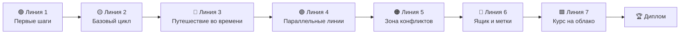

<div align="center">


<p>
  <a href="../README.md">🇧🇷 Português</a> ·
  <a href="README.en.md">🇬🇧 English</a> ·
  <a href="README.es.md">🇪🇸 Español</a> ·
  <a href="README.fr.md">🇫🇷 Français</a> ·
  <a href="README.de.md">🇩🇪 Deutsch</a> ·
  <a href="README.it.md">🇮🇹 Italiano</a> ·
  <b>🇷🇺 Русский</b> ·
  <a href="README.hi.md">🇮🇳 हिन्दी</a>
</p>

# 🚇 Git Quest

### Учите Git **играя**. Вводите настоящие команды, захватывайте станции и добирайтесь до облака.

<p>
  
  
  
  
  
  
</p>

<a href="https://gitquestgame.vercel.app/"></a>
<a href="https://bruno-a-dias.github.io/git-quest/"></a>

</div>

---

## 🔗 Играть сейчас

| Где | Ссылка |
|---|---|
| 🟣 **Vercel** (основная) | [gitquestgame.vercel.app](https://gitquestgame.vercel.app/) |
| ⚫ **GitHub Pages** (зеркало) | [bruno-a-dias.github.io/git-quest](https://bruno-a-dias.github.io/git-quest/) |

Оба адреса отдают одни и те же файлы. Если один недоступен, используйте другой.

---

## 🎮 Что это?

**Git Quest** — браузерная игра, которая учит Git с нуля и до `git push`. Никаких слайдов, набитых командами: ученик получает **историю** (вас только что наняла *Pizzaria do Zé*), **цель** и **имитацию терминала**, где вводятся настоящие команды. Игра проверяет результат, начисляет XP, повышает уровень и открывает следующую станцию.

> 💡 **Ничего не устанавливается и ничего не записывается на ваш компьютер.** Весь Git работает внутри страницы, на движке из чистого JavaScript. Ошибаться бесплатно — так и учатся.

| 🕹️ Вы | 🧠 Игра |
|---|---|
| Вводите `git add .` и `git commit -m "..."` | Обновляет 4 **анимированные** области Git рядом с терминалом |
| Создаёте ветку и сливаете её | Рисует **карту коммитов** с ветками, тегами и `HEAD` |
| Вызываете (и разрешаете) конфликт | Показывает маркеры `<<<<<<<` точно как настоящий Git |
| Просите помощи: **Подсказка 1 → Подсказка 2 → Показать решение** | Снижает XP, но никогда не оставляет ученика в тупике |

---

## 🗺️ Карта игры: 9 линий метро

Каждый **мир — это линия**, а каждая **миссия — станция** (ромбики — это квизы). Следующая станция открывается только после прохождения текущей.



| Линия | Тема | Чему учатся | Миссий |
|:--:|---|---|:--:|
| 🟢 **1** | Первые шаги | `git config`, `mkdir`, `cd`, `git init` | 3 |
| 🟡 **2** | Базовый цикл | `touch`/`echo`, `git add`, `git commit`, области Git | 5 |
| 🔴 **3** | Путешествие во времени | `git log`, `git diff`, `restore`, `commit --amend`, `revert`, `reflog` | 8 |
| 🟣 **4** | Параллельные линии | `git branch`, `git switch`, `git merge`, удаление веток | 5 |
| 🟠 **5** | Зона конфликтов | Конфликты слияния и чтение маркеров | 2 |
| 🔵 **6** | Ящик и метки | `git stash`, `git tag` | 3 |
| 🟩 **7** | Курс на облако | `git remote`, `push -u`, `pull`, `clone`, **финальный босс** | 6 |

**Всего 40 миссий**: 33 командные (3 на настоящем GitHub) и 7 блиц-квизов.

Линии 8 и 9 добавляют **продвинутый Git** (`rebase`, `bisect`, `worktree`) и **миссии на настоящем GitHub** (создать репозиторий, fork, Pull Request; проверка через публичный API GitHub). По пути ученик получает **14 трофеев в стиле PlayStation** (бронза, серебро, золото, платина), которые видны на обороте диплома рядом с треками. Игра работает и **офлайн** (PWA).

---

## ✨ Что удерживает внимание

- 🖥️ **Терминал как настоящий**: история на ↑ ↓, `Tab` дополняет команды и файлы, кликабельные ярлыки и подсказка при опечатке в команде.
- 🧩 **4 области Git в анимации**: рабочая папка → индекс → репозиторий → удалённый. При каждом `add`, `commit` и `push` файлы «перелетают» между областями.
- 🌿 **Карта коммитов в реальном времени**: граф в стиле схемы метро с ветками, тегами, `HEAD` и удалённым репозиторием, обновляется после каждой команды.
- ⚡ **XP, комбо и ранги**: шесть уровней — от *Стажёра коммитов* до *Мастера Git*. Миссии подряд без подсказок зажигают комбо.
- 🏅 **Достижения**: *Первый коммит*, *Путешественник во времени*, *Охотник за конфликтами*, *Мастер ящика*, *Голова в облаках*, *Клонировщик*, *Босс побеждён* и *Без костылей*.
- 💡 **Подсказки в три ступени**: Подсказка 1, Подсказка 2 и Показать решение (каждая строка решения кликабельна и попадает в терминал).
- 🎉 **Конфетти, звук и уведомления** (звук изначально выключен; ученик включает его при желании).
- 🎓 **Итоговый диплом** с именем ученика, XP, титулом и достижениями — готов для скриншота.
- 💾 **Прогресс сохраняется** в браузере, есть кнопка «начать заново».
- 🌍 **8 языков одним щелчком** (флаги сверху): миссии, подсказки, квизы, достижения и даже сообщения терминала переведены, выбор запоминается.
- 📱 **Адаптивность**: работает на телефоне и учитывает `prefers-reduced-motion`.

<div align="center">

| Слияние и карта коммитов | Разрешение конфликта |
|:--:|:--:|
|  |  |

| Курс на облако (push) | Блиц-квиз | На телефоне |
|:--:|:--:|:--:|
|  |  |  |

| 🇮🇳 На хинди | 🇩🇪 На немецком |
|:--:|:--:|
|  |  |

</div>

---

## 🌍 Языки

| | Язык | | Язык |
|:--:|---|:--:|---|
| 🇧🇷 | Português | 🇮🇳 | हिन्दी (Hindi) |
| 🇬🇧 | English | 🇷🇺 | Русский |
| 🇪🇸 | Español | 🇮🇹 | Italiano |
| 🇫🇷 | Français | 🇩🇪 | Deutsch |

Флаги в игре — **SVG, нарисованные вручную** (эмодзи флагов не отображаются в Windows). Начальный язык берётся из браузера, а выбор ученика сохраняется.

**Хотите добавить ещё один язык?** Скопируйте `js/lang/en.js` в `js/lang/xx.js`, переведите, добавьте флаг в список `LANGS` в `js/i18n.js` и тег `<script>` в `index.html`. `npm test` проверит, что ничего не пропущено.

> Команды (`git commit`, `git switch -c`…) никогда не переводятся: ученик должен вводить настоящую команду. Вывод самого Git остаётся английским, как в настоящем Git.

---

## 🧰 Команды, поддерживаемые симулятором

**Git (33):** `config` · `init` · `status` · `add` · `commit` · `log` · `show` · `diff` · `restore` · `reset` · `revert` · `rm` · `mv` · `clean` · `branch` · `switch` · `checkout` · `merge` · `cherry-pick` · `rebase` · `bisect` · `worktree` · `stash` · `tag` · `remote` · `push` · `fetch` · `pull` · `clone` · `reflog` · `ls-files` · `rev-parse` · `help`

**Shell:** `ls` · `cat` · `touch` · `echo` (`>` / `>>`) · `mkdir` · `cd` · `pwd` · `rm` · `clear`

Также понимает `HEAD~n`, `HEAD^`, `HEAD@{n}`, `.gitignore`, алиасы (`git config alias.*`) и настоящие конфликты слияния (трёхстороннее слияние, с маркерами).

---

## 🧑‍🏫 Для преподавателей

Создано для занятий:

- 🔓 **Режим преподавателя:** откройте страницу с `#professor` в конце адреса (`https://gitquestgame.vercel.app/#professor`), чтобы открыть все миссии — удобно для живых демонстраций.
- 📖 Каждая миссия указывает соответствующую **часть руководства** (части 1–14), чтобы игра сочеталась с основным материалом.
- 🔁 Подходит для **разминки** (10 минут), **лабораторной** или **домашнего задания**: прогресс сохраняется в браузере каждого ученика.
- 🔒 Без входа, без сервера, без сбора данных. Достаточно разместить статические файлы (GitHub Pages, Vercel, Netlify или флешка).
- 🧪 У 26 командных миссий есть **автоматически проверенное решение** на всех языках (`npm test`), так что невозможных станций нет.
- 📊 **Панель класса:** каждый студент нажимает **Прогресс** и присылает вам код; вставьте всё в [`professor.html`](https://gitquestgame.vercel.app/professor.html), чтобы увидеть рейтинг, кто закончил и где класс застревает, с экспортом в CSV. Диплом скачивается как **PNG-изображение** с проверочным кодом, который виден и в панели.

> **Идея урока:** покажите игру на проекторе, пройдите Линию 1 вместе, а затем пусть каждый идёт в своём темпе. Кто закончит первым, получает диплом и помогает одноклассникам.

---

## 🛠️ Запуск локально

Без сборки, без бандлера, без `npm install`. Только статические файлы.

```bash
git clone https://github.com/bruno-a-dias/git-quest.git
cd git-quest

# вариант 1: открыть прямо в браузере
open index.html            # macOS  (Linux: xdg-open · Windows: start)

# вариант 2: локальный сервер
npx serve .                # python3 -m http.server 8080
```

### ✅ Тесты (Node 18+)

```bash
npm test
```

Запускает три набора: **движок Git** (более 100 проверок команд и сообщений), **миссии** (решение каждой выполняется, все цели должны быть достигнуты) и **языки** (в каждом переводе должны быть все 32 миссии, тексты и достижения, а команды в подсказках не должны измениться).

### 🌐 Публикация на GitHub Pages

1. Отправьте репозиторий на GitHub.
2. Откройте **Settings → Pages**.
3. В разделе *Build and deployment* выберите **Deploy from a branch**, ветку `main` и папку `/ (root)`.
4. Через несколько минут игра будет доступна по адресу `https://bruno-a-dias.github.io/git-quest/`.
5. (По желанию) **Vercel:** импортируйте репозиторий на [vercel.com/new](https://vercel.com/new), оставьте *Framework Preset* равным **Other** и без команды сборки. Официальная версия проекта: `https://gitquestgame.vercel.app/`.

---

## 🧱 Как это устроено внутри

```
git-quest/
├── index.html              # структура страницы и порядок скриптов
├── css/
│   └── style.css           # стиль «схема метро на тёмной клетчатой бумаге»
├── js/
│   ├── git-engine.js       # движок Git + мини-shell (чистый JS, без зависимостей)
│   ├── missions.js         # миры, миссии, квизы, ранги и достижения (ДАННЫЕ, на португальском)
│   ├── i18n.js             # движок языков + SVG-флаги
│   ├── lang/               # по одному файлу на язык: en, es, fr, de, it, ru, hi
│   ├── core.js             # подготовка миссии и проверка целей
│   ├── ui-panels.js        # HUD, схема линий, области Git, граф, звуки, конфетти
│   └── ui-game.js          # терминал, ход миссии, подсказки, диплом, запуск
├── tests/                  # тесты движка, миссий и языков
├── i18n/                   # этот README на других языках
├── docs/                   # скриншоты для README
├── package.json
├── LICENSE
└── README.md
```

Скрипты обычные (без модулей) и **загружаются в таком порядке**, потому что используют общую глобальную область:

```html
<script src="js/git-engine.js"></script>
<script src="js/missions.js"></script>
<script src="js/i18n.js"></script>
<script src="js/lang/en.js"></script>   <!-- ... -->
<script src="js/core.js"></script>
<script src="js/ui-panels.js"></script>
<script src="js/ui-game.js"></script>
```

### 🔬 Движок Git

Репозиторий — это просто объект JavaScript: `{ head, branches, commits, index, stash, tags, remotes, server, reflog… }`. Каждая команда читает и изменяет эту модель и возвращает цветные строки для терминала. Есть `diff` на основе LCS, трёхстороннее слияние `merge` с обнаружением конфликтов, `reflog`, `stash` и имитация «сервера» для `push`, `fetch`, `pull` и `clone`. В случаях, которые встречаются на занятиях, результат совпадает с настоящим Git.

### 🎯 Как описывается миссия

Чтобы добавить станцию, достаточно добавить объект в `js/missions.js` (базовый текст — на португальском) и его перевод в каждый файл `js/lang/*.js`:

```js
{
  w: 3,                          // индекс мира (линии)
  title: 'Abrindo uma linha paralela',
  doc: 'Parte 8',
  story: '...',
  setup: BASE,                   // тихие команды, готовящие сценарий
  goals: [                       // проверяемые цели, а не просто «правильно набрал»
    { t: 'Criar a branch feature/sabores', ok: (g, ctx) => /* ... */ },
  ],
  hints: ['...', '...'],
  solution: ['git switch -c feature/sabores'],
  learn: '...'
}
```

Цели смотрят на **состояние репозитория** (`ok(g, ctx)`), поэтому подходит любой верный путь: `git switch -c`, `git checkout -b` или `git branch` + `git switch`.

### 🧮 Начисление очков

| Ситуация | XP |
|---|:--:|
| Командная миссия (без подсказок) | **100** |
| За каждую использованную подсказку | −25 (min 20) |
| Бонус: без ошибок **и** без подсказок | **+25** |
| Квиз с 1-й / 2-й / 3-й и далее попытки | **50 / 25 / 10** |

Ранги растут при долях от общего возможного XP, поэтому темп пути сохраняется, даже если добавить новые миссии.

---

## 🤝 Как помочь проекту

Идеи, которые были бы отличными:

- [ ] Дополнительный мир с `rebase`, `bisect` и `git worktree`
- [ ] Режим испытания на время
- [ ] Рейтинг класса (экспорт и импорт прогресса в файле)
- [ ] Больше языков (японский, арабский, китайский…)
- [ ] Новые сценарии помимо *Pizzaria do Zé*

Создайте *issue* с идеей или отправьте *pull request*. Сначала запустите `npm test`.


<h2 align="center">Герои Git Quest 🛡️</h2>

<table align="center" style="background-color: #121212; border-radius: 10px; border: none;">
  <tr>
    <!-- Card do Criador (Bruno) -->
    <td align="center" width="220" style="padding: 15px; border: 1px solid #FFD700; border-radius: 8px;">
      <a href="https://github.com/bruno-a-dias">
        <br />
        <br />
        <sub><b style="font-size: 16px; color: #FFFFFF;">Bruno Assunção Dias</b></sub>
      </a><br />
      <span style="color: #FFD700; font-weight: bold;">👑 Автор / мейнтейнер</span><br />
      <sub style="color: #A0A0A0;">DevQuest / Git Quest</sub>
    </td>

    <!-- NOVO_CONTRIBUIDOR_AQUI -->

  </tr>
</table>

---

## 👨‍🏫 Автор

**Prof. Me. Bruno Assunção Dias** · Преподаватель информационных технологий в **IESB**, Бразилиа-DF, Бразилия.
GitHub: [@bruno-a-dias](https://github.com/bruno-a-dias)

Сделано с ☕ и множеством `git commit`, чтобы ученики **перестали бояться терминала**.

## 📄 Лицензия

Распространяется по лицензии **MIT**. См. [`LICENSE`](../LICENSE). Используйте, адаптируйте и несите в свой класс.

<div align="center">

⭐ Если Git Quest помог вашему классу, поставьте репозиторию звезду!

</div>
